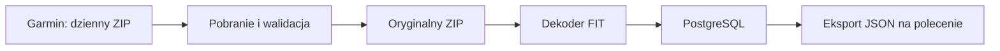

# Architektura i przechowywanie

## Przepływ



Pobieranie, dekodowanie i eksport to odrębne operacje. Zmiana parsera nie wymaga ponownego pobierania. Dekoder czyta FIT z ZIP; nie utrzymujemy osobnego rozpakowanego archiwum, zrzutów JSON ani kopii bazy.

## Proponowany układ

```text
data/
  raw/YYYY-MM-DD.zip
private/                 # sesja istniejącego skryptu historycznego; nie docelowego UI
exports/GarminDatabase_DATA_CZAS/  # osobny pakiet: history/, details/, manifest.json
logs/                    # log techniczny, bez wartości zdrowotnych i sekretów
```

Ścieżka danych jest konfigurowalna. Katalog zawiera oryginalne archiwa, a dane SQL znajdują się w osobnym serwerze PostgreSQL. Aplikacja zapisuje ścieżki archiwów względem katalogu danych. Serwer może działać na tym samym urządzeniu lub docelowym hoście; typ bazy i kod pozostają takie same. Konfiguracja: [PostgreSQL](13-postgresql-setup.md).

Aplikacja Windows zapisuje ustawienia w `%LOCALAPPDATA%/GarminDatabase/settings.json`, a sesję zaszyfrowaną DPAPI w `auth/session.bin` pod tym samym katalogiem. Nie zapisuje hasła ani kodu MFA. Skrypty przygotowawcze zachowują dotychczasowy sposób logowania. Szczegóły: [UI i ustawienia](11-desktop-ui.md).

## Interfejs i wspólna logika

Okno Windows jest warstwą obsługi wspólnych operacji pobierania, importu, ponownego przetwarzania i eksportu. Długie operacje działają poza wątkiem UI. Szczegółowe pomiary są dostępne dla pojedynczego dnia; dłuższe okresy pokazują podsumowania Garmin albo oznaczone średnie dzienne pięciu obsługiwanych parametrów pomiarowych.

Przeglądanie zatwierdzonych danych działa podczas importu przez oddzielne połączenia PostgreSQL z MVCC; odczyty używają `REPEATABLE READ READ ONLY`. Qt uruchamia import i zapytania wykresu poza wątkiem UI. Transakcja jednego FIT nie udostępnia częściowego wyniku. Eksport czyta wartości i metadane kompletności z jednego obrazu bazy, także gdy inny proces importuje kolejne pliki.

Zmiany parametru i filtrów automatycznie uruchamiają odczyt. UI wykonuje jedno zapytanie wykresu naraz, a przy kolejnych zmianach zachowuje ostatni wybór i odrzuca nieaktualne wyniki lub błędy. Oddzielna warstwa animacji pokazuje ładowanie nad rozmytym wykresem. Opcjonalna regresja liniowa używa wyłącznie punktów aktualnego wykresu; jest obliczeniem prezentacji i nie zmienia PostgreSQL ani plików JSON.

Raspberry Pi będzie w przyszłości uruchamiać te same operacje bez UI, według harmonogramu, i służyć jako hub dostępu do danych. Protokół dostępu, uwierzytelnianie i relacja z aplikacją Windows pozostają zakresem późniejszego etapu; połączenie z PostgreSQL używa protokołu serwera, bez współdzielenia pliku bazy przez sieć.

## Model PostgreSQL v1

Po skanowaniu pełnej pobranej historii ustalono [kompletny schemat](10-postgresql-schema.md), zapisany jako [wykonywalny SQL](../schema/001_initial.sql). Zastępuje on wcześniejszy szkic sześciu tabel. Obecny schemat jest przeznaczony dla pustej bazy PostgreSQL. Dawna walidacja pełnej historii dotyczyła SQLite i nie zastępuje odbioru nowego silnika.

Model rozdziela daty pobrania, oryginalne archiwa, wystąpienia FIT w ZIP, unikatowe treści FIT, przebiegi dekodowania, definicje wiadomości i pól, wiadomości danych oraz wartości pól. Katalog profilu przechowuje rozpoznane nazwy, jednostki i reguły dekodowania; pola nieznane pozostają w bazie pod identyfikatorami źródłowymi. Wartości skalarne mają typowane kolumny, tablice i struktury — JSON. Nie powielamy wartości dla rozwiniętych komponentów.

Migracja 003 dodaje odtwarzalną warstwę podsumowań. `summaries.py` liczy małe zestawienia dzienne na podstawie spójnego odczytu źródeł. Cache zapisuje osobnym połączeniem tylko wtedy, gdy nie trwa import i numer rewizji danych jest nadal ten sam. Zajęty writer albo nowy import nie unieważnia samego eksportu: wyniki odpowiadają jego wcześniejszemu obrazowi bazy. `v_current_daily_summaries` ukrywa nieaktualne cache; ponowny odczyt je odbudowuje. Podsumowania miesięczne powstają z dziennych i nie wymagają dodatkowej trwałej kopii.

Identyczny FIT obecny w kilku archiwach ma jedną reprezentację danych i wiele powiązań pochodzenia. Wartość identyfikuje klucz `(message_id, field_definition_id)`; definicja zachowuje przestrzeń nazw i indeks deweloperski w kontekście pliku. Indeksy obejmują czas, parametr, kategorię i hash pliku. Szczegółowe reguły integralności, czasu, ponownego przetwarzania i widoki są opisane w specyfikacji schematu.

## Wierność danych

- Oryginalny ZIP jest niezmieniany i pozostaje podstawą ponownego dekodowania.
- Zachować precyzję, tablice, kody wyliczeniowe, jednostki i oryginalne znaczniki czasu. Nie interpolować ani nie redukować próbek.
- Rozróżniać brak pola, wartość nieważną według FIT i błąd dekodowania. Nie zastępować ich zerem.
- Nie zgadywać znaczenia nieznanych pól. Zachować ich identyfikatory i odczytywalną reprezentację; nieobsługiwane dane pozostają również w oryginalnym FIT.
- Dzień żądania jest metadanym pobrania, nie automatycznie datą każdego pomiaru. Plik może zawierać rekordy przekraczające granicę dnia.
- `Europe/Warsaw` określa granicę „wczoraj”. Gdy dane podają UTC, zachować UTC i udostępniać jednoznaczną reprezentację czasu. Nie zakładać, że wszystkie lokalne czasy Garmin są czasem Warszawy. Czas niejednoznaczny oznaczyć, zwłaszcza przy zmianie czasu lub podróży.

## Trwałość

Pobranie jest zapisywane do pliku tymczasowego w katalogu docelowym, weryfikowane i atomowo przenoszone do nazwy docelowej. Istniejące archiwum nie jest nadpisywane. Tymczasowy plik jest usuwany po błędzie. Rejestracja archiwum i dekodowanie każdego FIT mają osobne transakcje PostgreSQL. Stany pobrania i dekodowania są niezależne; wznowienie pomija ukończone FIT.

Zapis jest chroniony blokadą sesyjną PostgreSQL advisory dla bazy/schematu oraz blokadą OS katalogu ZIP. Importer, inicjalizacja, synchronizacja i publikacja cache respektują tę samą blokadę. Awaria po zapisie ZIP, ale przed rejestracją w bazie, musi zostać rozpoznana przy następnym uruchomieniu: sprawdzić lokalny ZIP zamiast ponownie go pobierać.
