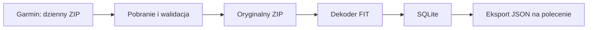

# Architektura i przechowywanie

## Przepływ



Pobieranie, dekodowanie i eksport to odrębne operacje. Zmiana parsera nie wymaga ponownego pobierania. Dekoder czyta FIT z ZIP; nie utrzymujemy osobnego rozpakowanego archiwum, zrzutów JSON ani kopii bazy.

## Proponowany układ

```text
data/
  raw/YYYY-MM-DD.zip
  garmin.sqlite3
private/                 # przyszła zapisana sesja
exports/                 # wynik eksportu na żądanie
logs/                    # log techniczny, bez wartości zdrowotnych i sekretów
```

Ścieżka danych jest konfigurowalna. Ma być możliwe przeniesienie archiwów i bazy przy wyłączonej aplikacji. SQLite używa ścieżek archiwów względem katalogu danych.

## Model SQLite — projekt do dopracowania po dekodowaniu próbki

| Tabela | Przeznaczenie i kluczowe pola |
| --- | --- |
| import_days | data żądania, stan pobrania, stan przetwarzania, liczba prób, czas ostatniej próby, bezpieczny kod błędu |
| archives | dzień żądania, względna ścieżka ZIP, SHA-256, liczba bajtów, czas pobrania |
| source_files | archiwum, nazwa wpisu FIT, SHA-256, typ pliku |
| fit_messages | plik źródłowy, kolejność wiadomości, numer wiadomości FIT, nazwa jeśli znana, czas źródłowy jeśli obecny |
| fit_fields | wiadomość, numer i nazwa pola, dane pola jako JSON, jednostka, typ wartości, identyfikator pola producenta i status dekodowania |
| schema_versions | wersja schematu, parsera i użytego profilu FIT |

Każdy rekord musi wskazywać źródłowy plik i pozycję. Klucz `(source_file_id, message_index, field_identity)` zapobiega duplikatom podczas ponownego przetwarzania. Tożsamość pola obejmuje także identyfikatory pól producenta. Wymusić klucze obce oraz indeksy czasu, parametru i pochodzenia.

Nie projektować wyłącznie tabel dla z góry znanych metryk: mogłoby to zgubić nowe lub nierozpoznane pola. Można później utworzyć widoki ułatwiające eksport konkretnych parametrów, bez osobnej kopii wartości.

## Wierność danych

- Oryginalny ZIP jest niezmieniany i pozostaje podstawą ponownego dekodowania.
- Zachować precyzję, tablice, kody wyliczeniowe, jednostki i oryginalne znaczniki czasu. Nie interpolować ani nie redukować próbek.
- Rozróżniać brak pola, wartość nieważną według FIT i błąd dekodowania. Nie zastępować ich zerem.
- Nie zgadywać znaczenia nieznanych pól. Zachować ich identyfikatory i odczytywalną reprezentację; nieobsługiwane dane pozostają również w oryginalnym FIT.
- Dzień żądania jest metadanym pobrania, nie automatycznie datą każdego pomiaru. Plik może zawierać rekordy przekraczające granicę dnia.
- `Europe/Warsaw` określa granicę „wczoraj”. Gdy dane podają UTC, zachować UTC i udostępniać jednoznaczną reprezentację czasu. Nie zakładać, że wszystkie lokalne czasy Garmin są czasem Warszawy. Czas niejednoznaczny oznaczyć, zwłaszcza przy zmianie czasu lub podróży.

## Trwałość

Pobranie zapisać do pliku tymczasowego w katalogu docelowym, zweryfikować i atomowo przenieść do nazwy docelowej. Nie nadpisywać istniejącego archiwum. Tymczasowy plik usunąć po błędzie. Każdy dzień przetwarzać w transakcji SQLite. Stany pobrania i dekodowania są niezależne.

Zastosować blokadę pojedynczego procesu zapisującego. Awaria po zapisie ZIP, ale przed rejestracją w bazie, musi zostać rozpoznana przy następnym uruchomieniu: sprawdzić lokalny ZIP zamiast ponownie go pobierać.
