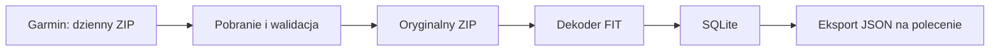

# Architektura i przechowywanie

## Przepływ



Pobieranie, dekodowanie i eksport to odrębne operacje. Zmiana parsera nie wymaga ponownego pobierania. Dekoder czyta FIT z ZIP; nie utrzymujemy osobnego rozpakowanego archiwum, zrzutów JSON ani kopii bazy.

## Proponowany układ

```text
data/
  raw/YYYY-MM-DD.zip
  garmin.sqlite3
private/                 # sesja istniejącego skryptu historycznego; nie docelowego UI
exports/GarminDatabase_DATA_CZAS/  # osobny pakiet: history/, details/, manifest.json
logs/                    # log techniczny, bez wartości zdrowotnych i sekretów
```

Ścieżka danych jest konfigurowalna. Ma być możliwe przeniesienie archiwów i bazy przy wyłączonej aplikacji. SQLite używa ścieżek archiwów względem katalogu danych.

Aplikacja Windows zapisuje ustawienia w `%LOCALAPPDATA%/GarminDatabase/settings.json`, a sesję zaszyfrowaną DPAPI w `auth/session.bin` pod tym samym katalogiem. Nie zapisuje hasła ani kodu MFA. Skrypty przygotowawcze zachowują dotychczasowy sposób logowania. Szczegóły: [UI i ustawienia](11-desktop-ui.md).

## Interfejs i wspólna logika

Okno Windows jest warstwą obsługi wspólnych operacji pobierania, importu, ponownego przetwarzania i eksportu. Długie operacje działają poza wątkiem UI. Szczegółowe pomiary są dostępne dla pojedynczego dnia; dłuższe okresy pokazują podsumowania Garmin albo oznaczone średnie dzienne pięciu obsługiwanych parametrów pomiarowych.

Przeglądanie zatwierdzonych danych działa podczas importu przez oddzielne połączenia SQLite w trybie WAL. Qt uruchamia import i zapytania wykresu poza wątkiem UI. Transakcja jednego FIT nie udostępnia częściowego wyniku. Eksport czyta wartości i metadane kompletności z jednego obrazu bazy, także gdy inny proces importuje kolejne pliki.

Zmiany parametru i filtrów automatycznie uruchamiają odczyt. UI wykonuje jedno zapytanie wykresu naraz, a przy kolejnych zmianach zachowuje ostatni wybór i odrzuca nieaktualne wyniki lub błędy. Oddzielna warstwa animacji pokazuje ładowanie nad rozmytym wykresem. Opcjonalna regresja liniowa używa wyłącznie punktów aktualnego wykresu; jest obliczeniem prezentacji i nie zmienia SQLite ani plików JSON.

Raspberry Pi będzie w przyszłości uruchamiać te same operacje bez UI, według harmonogramu, i służyć jako hub dostępu do danych. Protokół dostępu, uwierzytelnianie i relacja z aplikacją Windows pozostają zakresem późniejszego etapu; nie zakładamy obecnie współdzielenia pliku SQLite przez sieć.

## Model SQLite v1

Po skanowaniu pełnej pobranej historii ustalono [kompletny schemat](10-sqlite-schema.md), zapisany jako [wykonywalny SQL](../schema/001_initial.sql). Zastępuje on wcześniejszy szkic sześciu tabel. Zaimplementowany importer zasilił lokalną bazę pełną historią; wyniki walidacji są w [instrukcji](12-running-and-testing.md).

Model rozdziela daty pobrania, oryginalne archiwa, wystąpienia FIT w ZIP, unikatowe treści FIT, przebiegi dekodowania, definicje wiadomości i pól, wiadomości danych oraz wartości pól. Katalog profilu przechowuje rozpoznane nazwy, jednostki i reguły dekodowania; pola nieznane pozostają w bazie pod identyfikatorami źródłowymi. Wartości skalarne mają typowane kolumny, tablice i struktury — JSON. Nie powielamy wartości dla rozwiniętych komponentów.

Migracja 003 dodaje odtwarzalną warstwę podsumowań. `summaries.py` liczy małe zestawienia dzienne na podstawie spójnego odczytu źródeł. Cache zapisuje osobnym połączeniem tylko wtedy, gdy nie trwa import i numer rewizji danych jest nadal ten sam. Zajęty writer albo nowy import nie unieważnia samego eksportu: wyniki odpowiadają jego wcześniejszemu obrazowi bazy. `v_current_daily_summaries` ukrywa nieaktualne cache; ponowny odczyt je odbudowuje. Podsumowania miesięczne powstają z dziennych i nie wymagają dodatkowej trwałej kopii.

Identyczny FIT obecny w kilku archiwach ma jedną reprezentację danych i wiele powiązań pochodzenia. Wartość identyfikuje klucz `(message_id, field_definition_id)`; definicja zachowuje przestrzeń nazw i indeks deweloperski w kontekście pliku. Indeksy obejmują czas, parametr, kategorię i hash pliku. Szczegółowe reguły integralności, czasu, ponownego przetwarzania i widoki są opisane w specyfikacji schematu.

## Wierność danych

- Oryginalny ZIP jest niezmieniany i pozostaje podstawą ponownego dekodowania.
- Zachować precyzję, tablice, kody wyliczeniowe, jednostki i oryginalne znaczniki czasu. Nie interpolować ani nie redukować próbek.
- Rozróżniać brak pola, wartość nieważną według FIT i błąd dekodowania. Nie zastępować ich zerem.
- Nie zgadywać znaczenia nieznanych pól. Zachować ich identyfikatory i odczytywalną reprezentację; nieobsługiwane dane pozostają również w oryginalnym FIT.
- Dzień żądania jest metadanym pobrania, nie automatycznie datą każdego pomiaru. Plik może zawierać rekordy przekraczające granicę dnia.
- `Europe/Warsaw` określa granicę „wczoraj”. Gdy dane podają UTC, zachować UTC i udostępniać jednoznaczną reprezentację czasu. Nie zakładać, że wszystkie lokalne czasy Garmin są czasem Warszawy. Czas niejednoznaczny oznaczyć, zwłaszcza przy zmianie czasu lub podróży.

## Wspólny odczyt eksportu i MCP

`data_access.py` jest wspólną warstwą wyboru parametrów, opisu agregacji i odczytu podsumowań. `DataAccess.snapshot` otwiera jedno połączenie SQLite tylko do odczytu, transakcję WAL, katalog i rewizję. Wszystkie metryki oraz metadane kompletności jednej odpowiedzi korzystają z tego samego obrazu. Eksporter ponownie rozwiązuje klucze do aktualnych opisów katalogu, więc podanie własnych identyfikatorów pól lub skalowania nie omija wyboru użytkownika.

Eksport i MCP używają tych samych jednostek, reguł wykluczenia próbek, granic dni i niezaokrąglonych obliczeń. `period_summary` łączy średnie dni z wagą `valid_count`; korzysta z niego zarówno eksport miesięczny, jak i odczyt całego okresu. Źródłowe podsumowania Garmin, kategorie i liczniki nadal zachowują dotychczasowe znaczenie w plikach. MCP v1 obsługuje wyłącznie pięć jawnych `MEAN_PARAMETERS`, bez zgadywanych aliasów nocnego HRV lub tętna spoczynkowego.

`Summaries.daily(..., publish_cache=False)` odczytuje aktualny cache albo liczy wynik bez jego publikacji. MCP używa wyłącznie tego trybu i nie inicjalizuje/migruje bazy. Nie korzysta z sesji Garmin ani sieci Garmin. Eksport może publikować cache przez dodatkowe połączenie według dotychczasowych zasad rewizji i blokady writera. Rdzeń odczytu nie importuje Qt ani SDK MCP.

`mcp_data.py` zapewnia wybór metryk, kontrolę zapisanych ustawień przed i po odczycie, lokalne formatowanie czasu oraz limity. Zmiana bazy, rewizji danych lub polityki MCP unieważnia kursor powiązany z zapytaniem i podpisany kluczem procesu. Restart procesu także unieważnia kursory. Nie utrzymujemy otwartej transakcji między stronami. Po unieważnieniu klient rozpoczyna zapytanie od początku, aby nie łączyć różnych obrazów danych.

`mcp_server.py` jest adapterem oficjalnego SDK `mcp==1.28.0`, uruchamianym przez `mcp_stdio.py`. Używa lokalnego transportu `stdio`: klient uruchamia proces, a standardowe wyjście zawiera tylko protokół. Wynik jest w `structuredContent`; krótka część tekstowa nie powiela danych. Schematy wejściowe odrzucają dodatkowe pola, wymagają jawnych metryk, a wszystkie narzędzia są oznaczone jako odczytowe. Wyjątki techniczne są zastępowane krótkimi komunikatami bez danych i surowego SQL. Pojedynczy proces wykonuje jedno zapytanie danych naraz; anulowanie sygnalizuje przerwanie obliczeń i postępu SQLite.

Warstwa nie udostępnia operacji zapisu, SQL, plików FIT ani zdalnego HTTP. Obsługa aktywności, źródłowych podsumowań nocnych, okien godzinowych, median, odchylenia standardowego i porównywania okresów pozostaje późniejszym zakresem. Statystyki opisują obserwacje i nie zawierają interpretacji medycznej. Kontrakt narzędzi i uruchamianie opisuje [instrukcja](12-running-and-testing.md).

Specyfikacja transportu: [MCP stdio](https://modelcontextprotocol.io/specification/2025-11-25/basic/transports#stdio). Implementacja protokołu: [oficjalny Python SDK](https://github.com/modelcontextprotocol/python-sdk/tree/v1.x).

## Trwałość zapisu

Pobranie jest zapisywane do pliku tymczasowego w katalogu docelowym, weryfikowane i atomowo przenoszone do nazwy docelowej. Istniejące archiwum nie jest nadpisywane. Tymczasowy plik jest usuwany po błędzie. Rejestracja archiwum i dekodowanie każdego FIT mają osobne transakcje SQLite. Stany pobrania i dekodowania są niezależne; wznowienie pomija ukończone FIT.

Zastosować blokadę pojedynczego procesu zapisującego. Awaria po zapisie ZIP, ale przed rejestracją w bazie, musi zostać rozpoznana przy następnym uruchomieniu: sprawdzić lokalny ZIP zamiast ponownie go pobierać.
