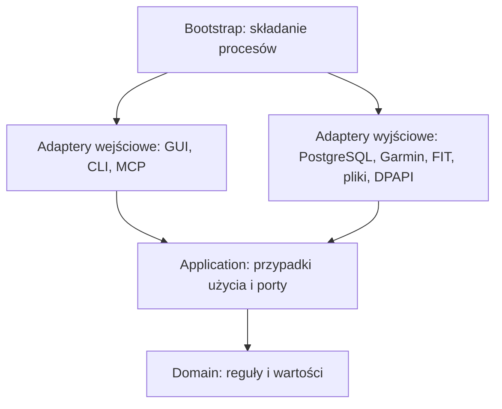
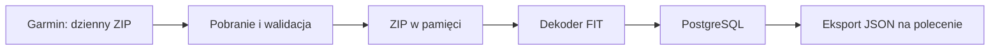

# Clean Architecture i przechowywanie

## Warstwy i zależności

Projekt stosuje Clean Architecture. Pakiet Pythona znajduje się w `src/garmin_database`, a testy w `tests/`. Reguły danych i przypadki użycia są niezależne od PostgreSQL, Qt, SDK Garmin i SDK MCP. Zewnętrzne technologie realizują kontrakty wymagane przez aplikację. Zależności przekazuje się przez konstruktory; składanie obiektów odbywa się w `bootstrap/`.



Strzałki oznaczają zależności kodu. W czasie wykonania przypadek użycia wywołuje port, którego implementację dostarcza adapter. Nie tworzy połączenia SQL ani klienta Garmin.

```text
src/garmin_database/
  domain/                 wartości, czas, anulowanie i czyste agregacje
  application/
    ports.py              kontrakty odczytu, importu, archiwów i eksportu
    settings.py           model ustawień i reguły udostępniania
    read_models.py        wybór parametrów i opisy agregacji
    dto.py                wyniki operacji bez zależności technicznych
    use_cases/            synchronizacja, logowanie, odczyt i eksport
  adapters/
    inbound/
      desktop/            okno, dialog MFA, workery i wykresy Qt
      cli/                argumenty poleceń i prezentacja wyników
      mcp/                protokół stdio, walidacja wejścia, konfiguracja klienta
    outbound/
      postgres/           transakcje, SQL, import, snapshoty i cache
      fit/                interpretacja fizycznych ramek i publiczny profil FIT
      garmin/             klient sieciowy i klasyfikacja błędów dostawcy
      filesystem/         ZIP, ustawienia JSON i atomowy eksport
      security/           magazyn sesji Windows DPAPI
      diagnostics/        bezpieczne komunikaty startowe
  bootstrap/              niezależne punkty wejścia GUI, CLI i MCP
  resources/              migracje SQL oraz ikony
tests/
  unit/                   reguły i przypadki użycia z atrapami portów
  integration/            prawdziwy PostgreSQL, FIT, zapis plików i rollback
  contracts/              kontrakt MCP, polityka i rzeczywisty transport stdio
  ui/                     zachowanie aplikacji Qt
  architecture/           automatyczne reguły zależności
  support/                syntetyczne generatory FIT/ZIP
schema/                   referencyjny SQL identyczny z zasobami pakietu
scripts/                  narzędzia deweloperskie; entrypoints/ dla PyInstaller
docs/                     aktualna dokumentacja produktu
local-runtime/            ignorowane launchery i lokalna sesja kolektora
local-notes/               ignorowane analizy i jednorazowe materiały administracyjne
test-results/             ignorowane wyniki testów i coverage
build/, dist/             ignorowane pliki budowania i dystrybucje
```

`domain` korzysta wyłącznie z biblioteki standardowej. `application` może importować domenę i własne kontrakty, lecz nie adaptery ani biblioteki dostawców. Adaptery wejściowe nie importują adapterów wyjściowych. Adaptery wyjściowe nie importują GUI, CLI ani MCP. Testy w `tests/architecture/` egzekwują te granice, a osobny test sprawdza brak Qt, klienta Garmin i dekoderów FIT po złożeniu procesu MCP.

Port odczytu udostępnia cały spójny snapshot, a nie niezależne repozytoria otwierające osobne transakcje. Port importu zachowuje atomowość jednego FIT; adapter PostgreSQL odpowiada za rollback, blokady i rewizję. Przypadek użycia eksportu wybiera dozwolone parametry w snapshotcie, a adapter plikowy zapisuje JSON. Te same czyste reguły agregacji obowiązują w eksporcie i MCP.

`bootstrap/desktop.py`, `bootstrap/cli.py` i `bootstrap/mcp.py` są niezależnymi punktami uruchomienia. MCP składa wyłącznie zależności odczytowe, nie inicjalizuje bazy, nie ładuje Qt ani usług importu i nie uruchamia GUI. Jest osobnym procesem EXE w tej samej dystrybucji. CLI korzysta z tych samych operacji co GUI bez importowania Qt.

## Przepływ



Pobieranie, dekodowanie i eksport to odrębne operacje. Ponowne dekodowanie danych sieciowych wymaga ponownego pobrania; lokalne starsze ZIP można nadal przetworzyć przez CLI. Dekoder czyta FIT z ZIP; nie utrzymujemy osobnego rozpakowanego archiwum, zrzutów JSON ani kopii bazy.

`application/use_cases/download_ahead.py` uruchamia jednego pracownika sieciowego, który może pobrać i zachować w pamięci następny ZIP podczas importu bieżącego. Nie wykonuje SQL. `Sync` pozostaje właścicielem blokady, inicjalizacji, prób i rejestracji w kolejności dni. Zamykanie operacji dołącza pracownika i zachowuje stan potrzebny do wznowienia. Nie ma niezależnych writerów dniowych ani zmiany algorytmu podsumowań.

`Sync.run_summary` zwraca `SyncSummary` z zakresem, osobnymi licznikami i wynikiem ostatniego dnia; `Sync.run` zachowuje liczbowy wynik problemów dla dotychczasowych wywołań. `Services.sync(detailed=True)` udostępnia wynik strukturalny GUI i CLI. `application/sync_messages.py` formatuje wspólne komunikaty całej operacji bez zależności od Qt. Wyniki podsumowania powstają z przebiegu operacji, bez dodatkowych skanów pomiarów w PostgreSQL.

Adapter PostgreSQL rozdziela obsługę archiwum (`imports.py`), kontekst ramek FIT (`fit_decode.py`), reguły katalogu (`fit_catalog.py`) i ograniczone partie SQL (`message_batch.py`). Zbiorczy INSERT wiadomości zwraca ID wraz z indeksem źródłowym, a COPY zapisuje pola do tych ID. Wszystkie partie jednego FIT należą do jednej transakcji, bez commitów przy flush. Szczegóły limitów i wznowienia: [synchronizacja](04-synchronization.md#wydajność-i-potok-synchronizacji).

## Układ zasobów

```text
data/
  raw/YYYY-MM-DD.zip  # wcześniejsze oryginały / lokalne źródła CLI
local-runtime/                 # lokalne zasoby wdrożenia; poza Git
exports/GarminDatabase_DATA_CZAS/  # osobny pakiet: history/, details/, manifest.json
logs/                    # log techniczny, bez wartości zdrowotnych i sekretów
```

Ścieżka danych jest konfigurowalna. Katalog może zawierać wcześniejsze oryginalne archiwa, a dane SQL znajdują się w osobnym serwerze PostgreSQL. Dla lokalnych ZIP aplikacja zapisuje ścieżki względem katalogu danych; remote/YYYY-MM-DD.zip to identyfikator sieciowego pochodzenia bez pliku na dysku. Serwer może działać na tym samym urządzeniu lub docelowym hoście; typ bazy i kod pozostają takie same. Konfiguracja: [PostgreSQL](13-postgresql-setup.md).

Aplikacja Windows zapisuje ustawienia w `%LOCALAPPDATA%/GarminDatabase/settings.json`, a sesję zaszyfrowaną DPAPI w `auth/session.bin` pod tym samym katalogiem. Nie zapisuje hasła ani kodu MFA. Szczegóły: [UI i ustawienia](11-desktop-ui.md).

## Interfejs i wspólna logika

Okno Windows jest warstwą obsługi wspólnych operacji pobierania, importu, ponownego przetwarzania i eksportu. Długie operacje działają poza wątkiem UI. Szczegółowe pomiary są dostępne dla pojedynczego dnia; dłuższe okresy pokazują podsumowania Garmin albo oznaczone średnie dzienne pięciu obsługiwanych parametrów pomiarowych.

Przeglądanie zatwierdzonych danych działa podczas importu przez oddzielne połączenia PostgreSQL z MVCC; odczyty używają `REPEATABLE READ READ ONLY`. Qt uruchamia import i zapytania wykresu poza wątkiem UI. Transakcja jednego FIT nie udostępnia częściowego wyniku. Eksport czyta wartości i metadane kompletności z jednego obrazu bazy, także gdy inny proces importuje kolejne pliki.

GUI ma osobny worker okresowego stanu i katalogu oraz pojedynczy worker czynności pomocniczych, takich jak zapis ustawień i otwarcie folderu. `OverviewPoller` wyznacza odstępy odczytów i odrzuca wyniki poprzedniej konfiguracji. Najpierw wywołuje `Services.overview` bez katalogu i publikuje liczniki oraz rewizję z jednego snapshotu. Następnie, jeśli upłynął odstęp kontroli katalogu, wywołuje `Services.catalog` w osobnym snapshotcie z własnym `catalog_revision`. Błąd katalogu zachowuje opublikowane liczniki i nie skraca odstępu ponowienia. Budżet i sygnał zatrzymania anulują aktywny SQL. `ReadFailure.reason` przekazuje wyłącznie bezpieczną kategorię: timeout, połączenie albo pozostały błąd bazy; GUI nie pokazuje treści wyjątku PostgreSQL. Wszystkie operacje SQL, sesji i plików wywoływane przyciskami działają w workerach; GUI aktualizuje widżety po sygnałach. Dialog wyboru folderu otwiera się przez `open()`, bez blokowania timerów. Częstotliwości i zachowanie wskaźników opisuje [kontrakt UI](11-desktop-ui.md).

Zapytanie katalogu sprawdza osobnym `EXISTS` obserwacje bezpośrednie i obserwacje źródeł reguł interpretacji, w obu przypadkach tylko w aktywnym dekodowaniu. Umożliwia to użycie indeksu `fields_parameter_message` dla obu ścieżek, bez materializowania całej historii pomiarów przez warunek równości połączony z korelowanym `IN`. Wiele reguł do tego samego celu nie powiela parametrów. Odczyty wartości eksportu i MCP nadal korzystają z jednego pełnego snapshotu.

Zmiany parametru i filtrów automatycznie uruchamiają odczyt. UI wykonuje jedno zapytanie wykresu naraz, a przy kolejnych zmianach zachowuje ostatni wybór i odrzuca nieaktualne wyniki lub błędy. Oddzielna warstwa animacji pokazuje ładowanie nad rozmytym wykresem. Opcjonalna regresja liniowa używa wyłącznie punktów aktualnego wykresu; jest obliczeniem prezentacji i nie zmienia PostgreSQL ani plików JSON.

Sortowanie punktów i obliczenie regresji odbywają się w workerze odczytu. Wyszukanie punktu pod kursorem używa wyszukiwania binarnego bez kopiowania współrzędnych wszystkich punktów przy każdym ruchu myszy. Ikony parametrów są współdzielone przez ograniczony cache w warstwie Qt.

Raspberry Pi będzie w przyszłości uruchamiać te same operacje bez UI, według harmonogramu, i służyć jako hub dostępu do danych. Protokół dostępu, uwierzytelnianie i relacja z aplikacją Windows pozostają zakresem późniejszego etapu; połączenie z PostgreSQL używa protokołu serwera, bez współdzielenia pliku bazy przez sieć.

## Model danych PostgreSQL

Model opisuje [schemat PostgreSQL](10-postgresql-schema.md), a jego wykonywalne migracje znajdują się w `schema/` oraz zasobach aplikacji. Nowa baza jest inicjalizowana transakcyjnie; aktualizacje schematu są wersjonowane i sprawdzane przez SHA-256.

Model rozdziela daty pobrania, oryginalne archiwa, wystąpienia FIT w ZIP, unikatowe treści FIT, przebiegi dekodowania, definicje wiadomości i pól, wiadomości danych oraz wartości pól. Katalog profilu przechowuje rozpoznane nazwy, jednostki i reguły dekodowania; pola nieznane pozostają w bazie pod identyfikatorami źródłowymi. Wartości skalarne mają typowane kolumny, tablice i struktury — JSON. Nie powielamy wartości dla rozwiniętych komponentów.

Migracja 003 dodaje odtwarzalną warstwę podsumowań. `domain/aggregation.py` i adapter `adapters/outbound/postgres/summaries.py` liczy małe zestawienia dzienne na podstawie spójnego odczytu źródeł. Cache zapisuje osobnym połączeniem tylko wtedy, gdy nie trwa import i numer rewizji danych jest nadal ten sam. Zajęty writer albo nowy import nie unieważnia samego eksportu: wyniki odpowiadają jego wcześniejszemu obrazowi bazy. `v_current_daily_summaries` ukrywa nieaktualne cache; ponowny odczyt je odbudowuje. Podsumowania miesięczne powstają z dziennych i nie wymagają dodatkowej trwałej kopii.

Identyczny FIT obecny w kilku archiwach ma jedną reprezentację danych i wiele powiązań pochodzenia. Wartość identyfikuje klucz `(message_id, field_definition_id)`; definicja zachowuje przestrzeń nazw i indeks deweloperski w kontekście pliku. Indeksy obejmują czas, parametr, kategorię i hash pliku. Szczegółowe reguły integralności, czasu, ponownego przetwarzania i widoki są opisane w specyfikacji schematu.

## Wierność danych

- Sieciowy ZIP jest buforem operacji, bez trwałego zapisu; tożsamość FIT i pochodzenie pozostają w SQL. Wcześniejszych lokalnych oryginałów nie usuwać.
- Zachować precyzję, tablice, kody wyliczeniowe, jednostki i oryginalne znaczniki czasu. Nie interpolować ani nie redukować próbek.
- Rozróżniać brak pola, wartość nieważną według FIT i błąd dekodowania. Nie zastępować ich zerem.
- Nie zgadywać znaczenia nieznanych pól. Zachować ich identyfikatory i odczytywalną reprezentację; ponowna analiza bajtów źródłowych wymaga pobrania lub posiadania starszego lokalnego FIT.
- Dzień żądania jest metadanym pobrania, nie automatycznie datą każdego pomiaru. Plik może zawierać rekordy przekraczające granicę dnia.
- `Europe/Warsaw` określa granicę bieżącego dnia. Gdy dane podają UTC, zachować UTC i udostępniać jednoznaczną reprezentację czasu. Nie zakładać, że wszystkie lokalne czasy Garmin są czasem Warszawy. Czas niejednoznaczny oznaczyć, zwłaszcza przy zmianie czasu lub podróży.

## Wspólny odczyt eksportu i MCP

`application/read_models.py` definiuje wspólny wybór parametrów i opis agregacji, a adapter `adapters/outbound/postgres/readings.py` realizuje odczyt podsumowań. `DataAccess.snapshot` otwiera jedno połączenie PostgreSQL `REPEATABLE READ READ ONLY`, katalog i rewizję. Wszystkie metryki oraz metadane kompletności jednej odpowiedzi korzystają z tego samego obrazu. Eksporter ponownie rozwiązuje klucze do aktualnych opisów katalogu, więc podanie własnych identyfikatorów pól lub skalowania nie omija wyboru użytkownika.

Eksport i MCP używają tych samych jednostek, reguł wykluczenia próbek, granic dni i niezaokrąglonych obliczeń. `period_summary` łączy średnie dni z wagą `valid_count`; korzysta z niego zarówno eksport miesięczny, jak i odczyt całego okresu. Źródłowe podsumowania Garmin, kategorie i liczniki nadal zachowują dotychczasowe znaczenie w plikach. MCP v1 obsługuje wyłącznie pięć jawnych `MEAN_PARAMETERS`, bez zgadywanych aliasów nocnego HRV lub tętna spoczynkowego.

`Summaries.daily(..., publish_cache=False)` odczytuje aktualny cache albo liczy wynik bez jego publikacji. MCP używa wyłącznie tego trybu i nie inicjalizuje/migruje bazy. Nie korzysta z sesji Garmin ani sieci Garmin. Eksport może publikować cache przez dodatkowe połączenie według dotychczasowych zasad rewizji i blokady writera. Rdzeń odczytu nie importuje Qt ani SDK MCP.

`application/use_cases/read_health.py` zapewnia wybór metryk, kontrolę zapisanych ustawień przed i po odczycie, lokalne formatowanie czasu oraz limity. Zmiana bazy, rewizji danych lub polityki MCP unieważnia kursor powiązany z zapytaniem i podpisany kluczem procesu. Restart procesu także unieważnia kursory. Nie utrzymujemy otwartej transakcji między stronami. Po unieważnieniu klient rozpoczyna zapytanie od początku, aby nie łączyć różnych obrazów danych.

`adapters/inbound/mcp/server.py` jest adapterem oficjalnego SDK `mcp==1.28.0`, uruchamianym przez `scripts/entrypoints/mcp_stdio.py`. Używa lokalnego transportu `stdio`: klient uruchamia proces, a standardowe wyjście zawiera tylko protokół. Wynik jest w `structuredContent`; krótka część tekstowa nie powiela danych. Schematy wejściowe odrzucają dodatkowe pola, wymagają jawnych metryk, a wszystkie narzędzia są oznaczone jako odczytowe. Wyjątki techniczne są zastępowane krótkimi komunikatami bez danych i surowego SQL. Pojedynczy proces wykonuje jedno zapytanie danych naraz; anulowanie sygnalizuje przerwanie obliczeń i zapytania PostgreSQL przez anulowanie sterownika i statement_timeout.

Warstwa nie udostępnia operacji zapisu, SQL, plików FIT ani zdalnego HTTP. Obsługa aktywności, źródłowych podsumowań nocnych, okien godzinowych, median, odchylenia standardowego i porównywania okresów pozostaje późniejszym zakresem. Statystyki opisują obserwacje i nie zawierają interpretacji medycznej. Kontrakt narzędzi i uruchamianie opisuje [instrukcja](12-running-and-testing.md).

Specyfikacja transportu: [MCP stdio](https://modelcontextprotocol.io/specification/2025-11-25/basic/transports#stdio). Implementacja protokołu: [oficjalny Python SDK](https://github.com/modelcontextprotocol/python-sdk/tree/v1.x).

## Trwałość zapisu

Pobranie jest walidowane i przechowywane wyłącznie w pamięci do końca importu.  Rejestracja archiwum wraz ze wszystkimi pochodzeniami FIT i dekodowanie każdego FIT mają osobne transakcje PostgreSQL. Pozostałe pliki są widoczne jako oczekujące przed publikacją pierwszego wyniku. Stany pobrania i dekodowania są niezależne; wznowienie pobiera ZIP ponownie i pomija ukończone FIT po ich SHA-256.

Zapis jest chroniony blokadą sesyjną PostgreSQL advisory dla bazy/schematu oraz blokadą OS katalogu ZIP. Importer, inicjalizacja, synchronizacja i publikacja cache respektują tę samą blokadę. Awaria przed ukończeniem importu wymaga ponownego pobrania dnia; transakcje ukończonych FIT pozostają zachowane.
