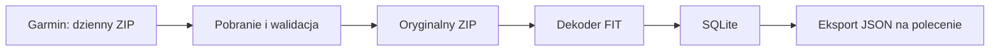

# Architektura i przechowywanie

## Przepływ



Pobieranie, dekodowanie i eksport to odrębne operacje. Zmiana parsera nie wymaga ponownego pobierania. Dekoder czyta FIT z ZIP; nie utrzymujemy osobnego rozpakowanego archiwum, zrzutów JSON ani kopii bazy.

## Proponowany układ

```text
data/
  raw/YYYY-MM-DD.zip
  garmin.sqlite3
private/                 # przyszła zapisana sesja
exports/                 # wynik eksportu na żądanie
logs/                    # log techniczny, bez wartości zdrowotnych i sekretów
```

Ścieżka danych jest konfigurowalna. Ma być możliwe przeniesienie archiwów i bazy przy wyłączonej aplikacji. SQLite używa ścieżek archiwów względem katalogu danych.

## Model SQLite v1

Po skanowaniu pełnej pobranej historii ustalono [kompletny schemat](10-sqlite-schema.md), zapisany jako [wykonywalny SQL](../schema/001_initial.sql). Zastępuje on wcześniejszy szkic sześciu tabel. Baza produkcyjna nie została jeszcze zasilona.

Model rozdziela daty pobrania, oryginalne archiwa, wystąpienia FIT w ZIP, unikatowe treści FIT, przebiegi dekodowania, definicje wiadomości i pól, wiadomości danych oraz wartości pól. Katalog profilu przechowuje rozpoznane nazwy, jednostki i reguły dekodowania; pola nieznane pozostają w bazie pod identyfikatorami źródłowymi. Wartości skalarne mają typowane kolumny, tablice i struktury — JSON. Nie powielamy wartości dla rozwiniętych komponentów.

Identyczny FIT obecny w kilku archiwach ma jedną reprezentację danych i wiele powiązań pochodzenia. Wartość identyfikuje klucz `(message_id, field_definition_id)`; definicja zachowuje przestrzeń nazw i indeks deweloperski w kontekście pliku. Indeksy obejmują czas, parametr, kategorię i hash pliku. Szczegółowe reguły integralności, czasu, ponownego przetwarzania i widoki są opisane w specyfikacji schematu.

## Wierność danych

- Oryginalny ZIP jest niezmieniany i pozostaje podstawą ponownego dekodowania.
- Zachować precyzję, tablice, kody wyliczeniowe, jednostki i oryginalne znaczniki czasu. Nie interpolować ani nie redukować próbek.
- Rozróżniać brak pola, wartość nieważną według FIT i błąd dekodowania. Nie zastępować ich zerem.
- Nie zgadywać znaczenia nieznanych pól. Zachować ich identyfikatory i odczytywalną reprezentację; nieobsługiwane dane pozostają również w oryginalnym FIT.
- Dzień żądania jest metadanym pobrania, nie automatycznie datą każdego pomiaru. Plik może zawierać rekordy przekraczające granicę dnia.
- `Europe/Warsaw` określa granicę „wczoraj”. Gdy dane podają UTC, zachować UTC i udostępniać jednoznaczną reprezentację czasu. Nie zakładać, że wszystkie lokalne czasy Garmin są czasem Warszawy. Czas niejednoznaczny oznaczyć, zwłaszcza przy zmianie czasu lub podróży.

## Trwałość

Pobranie zapisać do pliku tymczasowego w katalogu docelowym, zweryfikować i atomowo przenieść do nazwy docelowej. Nie nadpisywać istniejącego archiwum. Tymczasowy plik usunąć po błędzie. Każdy dzień przetwarzać w transakcji SQLite. Stany pobrania i dekodowania są niezależne.

Zastosować blokadę pojedynczego procesu zapisującego. Awaria po zapisie ZIP, ale przed rejestracją w bazie, musi zostać rozpoznana przy następnym uruchomieniu: sprawdzić lokalny ZIP zamiast ponownie go pobierać.
