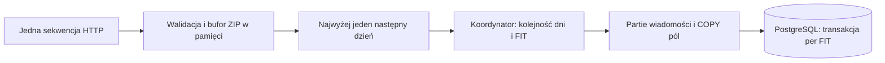

# Synchronizacja i obsługa błędów

## Przebieg synchronizacji

1. Ustal aktualną datę w `Europe/Warsaw`; maksymalny dzień importu to dzisiaj. Brak dodatkowego opóźnienia po północy.
2. Domyślny początek pobierania: 2024-01-01. GUI i lokalny kolektor korzystają ze wspólnego `download_from` w ustawieniach aplikacji; zakres eksportu jest niezależny. CLI może podać węższy okres przez `--from`.
3. „Pobierz nowe dane” zaczyna od ostatniego dnia zarejestrowanego archiwum (włącznie), uwzględniając także wcześniejsze błędy i niekompletne importy. Przy pustej bazie zaczyna od początku zakresu. Znane nierozstrzygnięte HTTP 404 pozostają jawne i nie są ponawiane w tym trybie.
4. „Pobierz wszystko” sprawdza cały zakres, również ponawiając nierozstrzygnięte dni. Nie wymusza ponownego dekodowania istniejących kompletnych FIT.
5. Pobierz i zweryfikuj ZIP w pamięci. Zarejestruj pochodzenia FIT i deduplikuj je po SHA-256 w PostgreSQL. Nazwa ani pozycja wpisu w kolejnym ZIP nie jest identyfikatorem treści FIT.
6. Importuj nowe lub nieukończone FIT. Po błędzie lub anulowaniu wznowienie pobiera dzień ponownie; ukończone FIT zachowują wyniki. Nie ma trwałego zapisu nowych ZIP ani rozpakowanych FIT.
7. Wyświetl wynik każdego dnia i podsumowanie operacji. Dzisiejsze dane mogą być niepełne; otrzymanie późniejszego FIT nie dowodzi, że Garmin udostępnił wszystkie wcześniejsze pomiary.

Odczyty, eksport i MCP dopuszczają bieżący dzień Europe/Warsaw. Kompletność oznacza go jako potencjalnie niepełny, także gdy wszystkie dotychczas otrzymane FIT są ukończone. Program nie usuwa wcześniejszych archiwów użytkownika. Import lokalny i wymuszone dekodowanie pozostają pomocniczymi poleceniami CLI.

## Stany

- Pobranie: `pending`, `downloaded`, `empty_zip`, `not_found_unverified`, `no_data_confirmed`, `failed`, `local_invalid` — zgodnie z ograniczeniami schematu SQL.
- Przetwarzanie pojedynczego FIT: brak ukończonego wyniku, `complete`, `partial`, `failed`; przerwany przebieg ma osobny status `interrupted`.
- `partial` oznacza zachowanie części rekordów z jednoznacznym opisem ograniczeń; eksport musi sygnalizować niepełne dekodowanie.
- `no_data_confirmed` wymaga udokumentowanej odpowiedzi potwierdzającej brak archiwum dla daty. 401, 403, 429, błędy serwera i nieznane 404 pozostają błędami, dopóki zachowanie endpointu nie zostanie zweryfikowane. Znane `not_found_unverified` są pomijane przy wznowieniu, nadal widoczne jako nierozstrzygnięte; nie stają się potwierdzonym brakiem danych.

Sprawdzać cały wybrany zakres od początku pobierania (domyślnie 2024-01-01): nie kończyć wyszukiwania przy pierwszym dniu bez danych. Pierwsza data dostępnego archiwum i pierwszy czas odczytanego pomiaru to dwie różne informacje.

## Błędy i wznowienie

Żądania HTTP są sekwencyjne i mogą nakładać się na import poprzedniego ZIP. Nie ma równoległego masowego pobierania. Klient ma timeouty; aplikacja podejmuje najwyżej trzy próby na dzień z lokalną przerwą 3 s i zwiększeniem odstępu po błędzie. Nagłówek `Retry-After`, w sekundach lub jako data HTTP, zwiększa odstęp przed ponowieniem. 401, 403 i 429 zatrzymują bieżące pobieranie; także pięć kolejnych nieudanych dni powoduje zatrzymanie. Postęp jest zachowany. Przed ręcznym wznowieniem po 429 należy odczekać; aplikacja nie ponawia automatycznie takiego żądania. To parametry aplikacji, nie deklarowane limity Garmin.

Nie logować odpowiedzi zawierających zdrowotne dane, hasła, kody MFA, ciasteczka ani tokeny. W panelu szczegółów UI oraz przyszłym trybie bez UI wystarczą data, etap, status i bezpieczny kod błędu.

HTTP 404 jest opisywane jako brak zwróconego archiwum dla konkretnej daty, bez rozstrzygania, czy konto nie ma wtedy danych. Synchronizacja sprawdza kolejne dni. Przy wznowieniu zapisany `not_found_unverified` nie wysyła ponownego żądania, ale pozostaje w liczbie nierozstrzygniętych dni i otrzymuje osobny komunikat w szczegółach. Nie wolno prezentować takiego wznowienia jako pełnego sukcesu.

Błąd importu FIT emituje komunikat z datą, numerem pliku w archiwum i klasą błędu; nieukończona transakcja FIT jest wycofana, a wznowienie pobiera ZIP ponownie. Dziennik operacji jest stale widoczny na widoku głównym; po zakończeniu UI dopisuje podsumowanie, także dla błędów i nierozstrzygniętych dni. Nowa operacja pobierania, importu lub eksportu czyści panel poprzedniej operacji.

Komunikat „Rozpoczynanie importu FIT (n/N)” oznacza początek przetwarzania pliku. Po obsłużeniu archiwum aplikacja emituje osobny **„Wynik dnia”**: import bez błędów, liczba błędów FIT, błąd archiwum/pobierania, nierozstrzygnięty HTTP 404 albo pominięcie w trybie lokalnym. Sukces dotyczy danego dnia, także gdy inne dni w operacji pozostają nierozstrzygnięte.

**„Podsumowanie całej operacji”** podaje żądany zakres, liczbę obsłużonych dni i osobne kategorie z jednostkami: dni z poprawnym importem, potwierdzony brak danych, pominięte dni bez lokalnego ZIP, błędy pobierania w dniach, błędy importu FIT w plikach, błędy archiwów w dniach oraz dni nierozstrzygnięte HTTP 404. Dla 404 podaje granice dat i przypomina, że brak danych nie został potwierdzony. Wynik ostatniego obsłużonego dnia jest osobną informacją. Nierozstrzygniętych 404 nie dodaje się do licznika błędów importu; przerwanie przed końcem zakresu jest jawne. CLI zachowuje niezerowy kod także przy samych nierozstrzygniętych dniach oraz końcowy JSON stanu po podsumowaniu tekstowym.

„Pobierz nowe dane” i „Pobierz wszystko” wykonują pobieranie i przyrostowy import do PostgreSQL. Pasek postępu pokazuje aktualny dzień, etap i licznik ukończonych dni. „Zatrzymaj” bezpiecznie kończy pracę z zachowaniem transakcji i postępu. Zamknięcie okna podczas pracy ręcznej wymaga potwierdzenia zatrzymania i wyjścia. Okno nie pracuje w zasobniku. Osobny [kolektor cykliczny](15-scheduled-collector.md) używa tego samego Sync i harmonogramu systemowego; zamknięcie GUI nie wyłącza jego zadania. Zajęta blokada powoduje tylko wpis w logu automatu i oczekiwanie do następnego zwykłego terminu.

## Logowanie

Logowanie odbywa się w formularzu ustawień Windows: e-mail, maskowane hasło i kod MFA, jeśli konto go wymaga. Hasło i kod nie są zapisywane. Sesja jest przechowywana poza projektem i bazą, w `%LOCALAPPDATA%/GarminDatabase/auth/session.bin`, zaszyfrowana DPAPI w zakresie użytkownika Windows. Wygaśnięcie sesji wymaga ponownego logowania i nie niszczy istniejących danych. Przeniesienie na inny komputer wymaga nowego logowania. Import lokalny i odczyty MCP nie wymagają logowania Garmin.

Kolektor ma oddzielne logowanie CLI i sesję konta zadania. Linux/Pi używa szyfrowanego magazynu z poświadczeniem systemd. Brak sesji, lokalny błąd jej zabezpieczenia i odmowa HTTP mają strukturalne wyniki, a automatyzacja zachowuje pauzę sesji i Retry-After między procesami. Uszkodzony magazyn sesji nie wywołuje kolejnych prób sieciowych wewnątrz operacji.

## Polecenia realizowane przez moduł CLI

```text
python -m garmin_database.bootstrap.cli sync
python -m garmin_database.bootstrap.cli sync --from 2024-01-01 --to 2026-09-30
python -m garmin_database.bootstrap.cli status
python -m garmin_database.bootstrap.cli reprocess --from 2024-01-01
```

`sync` nadgania brakujące dni do dzisiaj. `reprocess` działa wyłącznie na lokalnych archiwach. `sync-all` ponownie pobiera cały zakres, `sync` pobiera przyrostowo.

## Wydajność i potok synchronizacji

Synchronizacja ma jednego właściciela SQL i jednego pracownika sieciowego. Po pobraniu i pełnej walidacji ZIP w pamięci koordynator rejestruje próbę następnego dnia i zleca pobranie w tle. W tym czasie importuje bieżący ZIP. Oczekuje najwyżej jeden kolejny dzień; bufor przechowuje najwyżej jeden kolejny ZIP oprócz aktualnie importowanego. Klient Garmin zwraca w pamięci jeden bieżący ZIP, którego rozmiar zależy od danych źródłowych.



Blokada writera i inicjalizacja obejmują całą operację. Sieciowy pracownik nie korzysta z repozytorium, PostgreSQL ani dekodera FIT. Wszelkie zapisy SQL, w tym próby, błędy, rejestracja i dekodowanie, wykonuje koordynator na tym samym wątku co właściciel blokady. Rejestruje dni chronologicznie i wpisy ZIP w kolejności źródłowej, zachowując dotychczasowe rozstrzyganie remisów przez ID. Nie zmienia to algorytmu podsumowań ani wersji schematu.

Przerwa domyślna 3 s zaczyna się przed kolejnym żądaniem, po zakończeniu poprzedniego pobrania; może upływać podczas importu. Aplikacja wykonuje najwyżej trzy próby. `retry_attempts=0` wyłącza dodatkowe ponowienia SDK; `Retry-After` i oczekiwanie przed ponowieniem należą do koordynatora. Są to ustawienia aplikacji, nie deklarowane limity Garmin. Odpowiedź 401/403/429 pobrana z wyprzedzeniem nie uruchamia następnego żądania; można dokończyć import bieżącego archiwum, zanim koordynator zaprezentuje błąd kolejnego dnia.

Anulowanie przerywa oczekiwanie koordynatora, przerwę sieciową i dekodowanie. Zamykanie operacji dołącza pracownika zamiast pozostawiać go w tle. Bieżące żądanie HTTP może wymagać oczekiwania do zakończenia/timeoutu. Po anulowaniu bufory ZIP są zwalniane; wznowienie ponawia pobieranie. Jeśli pracownik otrzymał nierozstrzygnięte 404, koordynator zapisuje ten stan także podczas anulowania, bez powtórzenia żądania przy wznowieniu. Próba anulowana podczas przerwy, przed wywołaniem źródła, jest wycofywana z licznika prób. Pracownik sieciowy nie zapisuje ZIP na dysku.

### Partie SQL i atomowość

`MessageBatch` buforuje do 512 wiadomości, 4096 pól lub szacowanych 2 MiB danych w partii. Pierwszy osiągnięty limit powoduje zapis; pojedyncza większa wiadomość jest zapisywana samodzielnie. Limity dotyczą dodatkowego bufora partii, nie całego rozmiaru ZIP/FIT zwróconego przez dekoder.

Wiadomości trafiają do jednego `INSERT ... SELECT FROM unnest(...) RETURNING id,message_index`; ID generuje PostgreSQL IDENTITY. Pola są dopasowywane po indeksie wiadomości źródłowej, nigdy po kolejności zwróconych ID ani założeniu ich ciągłości, i trafiają do `COPY fit_fields` z jawną listą kolumn. Typowane wartości raw, tablice, null, tekst UTF-8 i uint64 poza BIGINT zachowują dotychczasową reprezentację.

Każda partia należy do tej samej transakcji FIT. Flush nie wykonuje commitu. Końcowy błąd CRC lub anulowanie cofa wszystkie zapisane partie tego FIT, także wymianę wcześniejszego dekodowania i jego rewizję. Dopiero poprawny koniec FIT aktywuje wynik i zatwierdza transakcję. Błąd SQL zachowuje wcześniejszy wynik i nie oznacza oryginalnych bajtów FIT jako uszkodzonych; status integralności `invalid` wymaga błędu dekodera FIT.

Przed rozpoczęciem dekodowania pierwszego FIT importer odczytuje i weryfikuje CRC wszystkich wpisów ZIP, liczy ich SHA-256 i rejestruje wszystkie powiązania w jednej transakcji metadanych. Dzięki temu snapshot czytelnika widzi pozostałe FIT jako oczekujące, zamiast pozornie kompletnego dnia po pierwszym pliku. Dla już zarejestrowanych wpisów nie wykonuje ponownych INSERT i nie podbija rewizji pustym ON CONFLICT. Sieciowy ZIP jest sprawdzany przy każdym pobraniu. Kompletne FIT w tym samym profilu są pomijane; bez nowych lub nieukończonych FIT nie powstaje decode_runs. Lokalny importer CLI zachowuje skrót dla identycznego kompletnego ZIP.

### Kolejność i podsumowania

Paczka dzienna jest jednostką planowania żądania, nie gwarantowaną partycją czasu pomiarów ani pojedynczą transakcją PostgreSQL. Jeden ZIP może zawierać czasy spoza dnia żądania. Atomowy pozostaje FIT: po błędzie następnego pliku wcześniejsze ukończone wyniki dnia zostają zachowane, a kompletność sygnalizuje pozostałe pliki. Rekonstrukcja skróconych czasów i redefinicje zachowują kontekst oraz kolejność ramek w pliku, również pomiędzy partiami SQL.

Deduplikacja pozostaje oparta o SHA-256 całego FIT; różne pliki z takimi samymi timestampami nie są scalane. Średnia dzienna obejmuje wszystkie poprawne próbki według czasu pomiaru w Europe/Warsaw. Okresowa używa wag `valid_count`; nie uśrednia wyników tasków lub ZIP z jednakową wagą. Podsumowania nadal powstają na żądanie odczytu, ze spójnego snapshotu. Cache nie publikuje wyników podczas aktywnego writera ani po zmianie rewizji.

Odczyt nadal rozstrzyga identyczne czasy przez `fit_file_id`, `message_index` i `field_definition_id`. Wdrożony potok zachowuje kolejność rejestracji, więc nie wprowadza nowej zależności od kolejności kończenia HTTP. Dowolna kolejność rejestracji w przyszłości wymaga stabilnego porządku źródłowego albo dalszej koordynacji, a zmiana reguły agregacji — unieważnienia cache przez wersję algorytmu.

### Granice dalszej równoległości

Nie uruchamiać niezależnych Sync.run ani importerów dla kolejnych dni w puli wątków. Inicjalizacja zakłada brak aktywnego importera; jej odzyskiwanie stanu oznacza porzucone `running` jako `interrupted`. Globalna blokada writera pozostaje obowiązująca, a triggery rewizji blokują wspólny wiersz dataset_state do końca FIT. Ewentualni równolegli writerzy wymagają własności dekodowania według SHA-256, ponownego sprawdzenia ukończenia pod blokadą i nowego protokołu rewizji/cache. Samo UNIQUE nie zastępuje takiej koordynacji.

Działa jeden dekoder FIT. Ostrzeżenia przechwycone podczas dekodowania są filtrowane do źródeł fitdecode, aby ostrzeżenie biblioteki sieciowej nie oznaczyło pliku jako partial. `warnings.catch_warnings` w Pythonie 3.12 nadal nie izoluje równoległych dekoderów wątkowych. Ewentualne procesy CPU wymagają oddzielenia parsera od SQL, limitów IPC i odbioru Windows/PyInstaller. Równoległe żądania HTTP wymagałyby osobnego globalnego limitera i zarządzania sesją; obecny pracownik ma wyłączność na klienta i zapis odnawianych tokenów.

Warunki odbioru oraz powtarzalny pomiar przyspieszenia opisuje [uruchamianie i testy](12-running-and-testing.md#pomiar-wydajności-importu).
