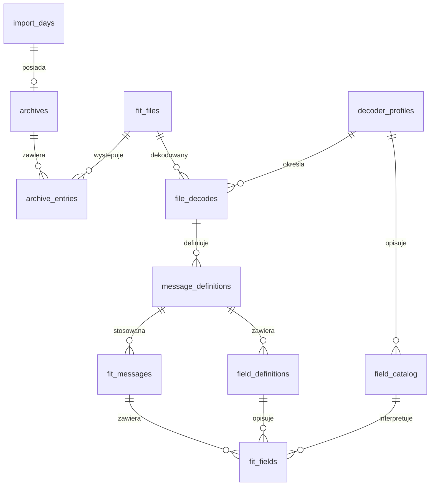

# Kompletny schemat SQLite v1

Definicja wykonywalna: [schema/001_initial.sql](../schema/001_initial.sql). Jest to schemat docelowy, sprawdzany na bazie w pamięci. Baza produkcyjna nie została jeszcze utworzona ani zasilona pomiarami. Wyniki skanowania źródeł opisano w [analizie FIT](08-fit-analysis.md), a wszystkie wykryte pola w [katalogu](09-fit-field-catalog.md).

## Decyzja

Przechowujemy fizyczne pola FIT z ich wartościami źródłowymi, definicjami i pochodzeniem. Nazwane parametry są warstwą interpretacji publicznego profilu FIT. Brak nazwy lub jednostki nie powoduje odrzucenia pola. Nie tworzymy osobnych tabel zdrowotnych o stałej liście kolumn, ponieważ nie obejmowałyby wielu prywatnych wiadomości Garmin.

Ustalony zestaw: `fitdecode==0.11.0` do struktury, fizycznych definicji i wartości raw oraz publiczny profil `garmin-fit-sdk==21.218.0` do aktualnych nazw, jednostek i reguł. Oficjalny profil rozpoznaje dodatkowo 36 wariantów, w tym `nap_event` i wiadomości nasilenia zakłóceń snu. W `decoder_profiles.options_json` zapisać obie wersje, pochodzenie semantyki i sposób rozwijania. Reguły wariantu, np. `steps`, mają pierwszeństwo przed skalą pola nadrzędnego `cycles`. Nie nakładać konwersji profilu SDK na już przeskalowane wartości `fitdecode.value` — źródłem jest `raw_value`.

Oryginalny ZIP pozostaje na dysku. Baza nie kopiuje całych FIT jako BLOB ani nie utrzymuje rozpakowanych plików. Identyczne FIT występujące w różnych ZIP mają jedną reprezentację danych w bazie i wiele powiązań z archiwami. To deduplikacja bajtów pliku po SHA-256, nie zgadywanie, czy podobne pomiary są duplikatami.

W przeanalizowanej historii wszystkie 10 994 FIT mają różne hashe; mechanizm deduplikacji zabezpiecza przyszłe importy, ale nie zmniejszy obecnego zbioru. Rozmiar projektowany obejmuje około 8,31 mln wiadomości i 20,84 mln fizycznych pól. Nie stosujemy deduplikacji po samej parze czas–wartość ani odrzucania powtarzających się wartości.

## Tabele

| Tabela | Rola |
| --- | --- |
| `schema_migrations` | Zastosowane migracje i hash ich SQL. |
| `decoder_profiles` | Wersja parsera, profilu FIT oraz opcje dekodowania. |
| `import_days` | Wszystkie sprawdzone daty, status pobrania, próby i bezpieczne metadane błędu. |
| `archives` | Jeden oryginalny ZIP dla daty; ścieżka względna, rozmiar i SHA-256. |
| `fit_files` | Unikatowe treści FIT identyfikowane SHA-256; wersje nagłówka i integralność. |
| `archive_entries` | Każde wystąpienie pliku w ZIP, z pozycją wpisu, nazwą i kategorią. |
| `decode_runs` | Przebieg zadania dekodowania. |
| `file_decodes` | Stan dekodowania konkretnego pliku określoną wersją parsera. |
| `field_catalog` | Nazwy, jednostki, skala, offset i semantyka pól według przypiętego profilu. |
| `message_definitions` | Definicje lokalnych wiadomości FIT, globalny numer, kolejność bajtów i pozycja w pliku. |
| `field_definitions` | Fizyczne pola danej definicji: numer, kolejność, typ bazowy, rozmiar i przestrzeń nazw. |
| `fit_messages` | Każda wiadomość danych, kolejność i pozycja, opcjonalny czas z jawną podstawą jego odtworzenia. |
| `fit_fields` | Jedna wartość źródłowa każdego fizycznego pola wiadomości. |
| `interpretation_rules` | Reguły z profilu dla subpól, komponentów i rekonstrukcji czasu; bez własnych wskaźników zdrowia. |
| `decode_issues` | Nieobsługiwane fragmenty i błędy, przypisane do pliku/wiadomości/pola. |

## Relacje i klucze

`fit_files.sha256` zapobiega powielaniu identycznych treści. `archive_entries` używa pozycji wpisu w ZIP, ponieważ same nazwy nie muszą być unikalne. Wiadomość ma unikatowy klucz `(file_decode_id, message_index)`. Wartość ma klucz `(message_id, field_definition_id)`. Klucze złożone pilnują, aby wartość nie została przypisana do pola z innej definicji.

Numery lokalnych wiadomości są wielokrotnie używane i redefiniowane wewnątrz FIT. Nie mogą być kluczem wiadomości ani zastępować kolejności definicji. Numery pól są unikatowe tylko w kontekście wiadomości i przestrzeni nazw, nie globalnie w całej bazie.

## Reprezentacja wartości

`fit_fields` przechowuje jedną z pięciu reprezentacji niepustych: `INTEGER`, `REAL`, tekst, tablicę/strukturę JSON albo tekstową reprezentację całkowitej liczby przekraczającej zakres SQLite INTEGER. CHECK wymusza dokładnie jedną aktywną kolumnę. `null` ma wszystkie kolumny wartości puste.

Wartości skalarne nie są pakowane do JSON. Tablice zachowują długość, kolejność i pozycje `null`, także gdy część elementów jest nieważna według FIT. `uint64` spoza zakresu signed int64 należy zapisać jako liczbę dziesiętną w tekście; w tablicach stosować jawnie oznaczone obiekty, np. `{"integer_text":"18446744073709551614"}`. Nie konwertować takich liczb do REAL. Bajty są tablicą liczb 0–255, a nie zgadywanym tekstem. Nieprawidłowe sekwencje tekstowe pozostają odtwarzalne z oryginału i muszą mieć wpis w `decode_issues`.

`validity` rozróżnia poprawne pole, nieważną wartość FIT, częściowo nieważną tablicę i błąd dekodowania. „Valid” oznacza poprawność reprezentacji FIT, nie prawidłowy wynik zdrowotny ani pełną interpretację wszystkich kodów specjalnych. Wartości specjalne mieszczące się w typie bazowym pozostają zachowane. Brak pola w definicji to brak wiersza, nie zero ani `null` z pomiaru. Sentinel nieważności rozpoznaje dekoder według typu bazowego; jego oryginalne bajty pozostają w ZIP.

Przechowujemy wartości przed skalowaniem. Rozpoznane pola skalarne udostępnia widok `v_numeric_parameters`, stosujący wyłącznie regułę profilu `raw / scale - offset`. Jest to dekodowanie jednostki, nie obliczanie nowego wskaźnika. Widok wymaga jawnego `numeric_projection_enabled=1` w katalogu: importer włącza go dopiero dla jednoznacznej reguły skalarnej. Pola bitowe, wieloskładnikowe i enumy nie stają się automatycznie pomiarami liczbowymi. Tablicowe reguły skali i jednostek SDK pozostają w `profile_metadata_json`. Typy wyliczeniowe zachowują kody; etykiety pochodzą z metadanych profilu. Pola nieznane nie otrzymują zgadywanej skali ani jednostki.

## Subpola i komponenty

`steps` może być wariantem fizycznego pola `cycles`. Rozwinięcie komponentu może tworzyć parametr, którego nie ma jako osobnego pola w bajtach FIT. Nie zapisujemy drugiej kopii wartości dla każdej etykiety generowanej przez parser. Fizyczne pole pozostaje raz w `fit_fields`; jego właściwy wariant otrzymuje `resolved_catalog_id`, a reguły dalszych rozwinięć są w `interpretation_rules`.

Katalog identyfikuje wariant pełnym `stable_key`, nie samym numerem pola. Importer musi odwzorować fizyczne pola po `field_def`, a nie zapisać bez rozróżnienia każdy obiekt `FieldData`, ponieważ część z nich jest rozwinięciem. Dla akumulowanych/bitowych komponentów exporter stosuje przypięte reguły profilu i stan wiadomości w pliku. Wyniki takich rozwinięć powstają na odczycie, bez utrzymywania drugiej trwałej kopii pomiarów.

## Czas

Data archiwum opisuje żądanie do WebAPI. Nie jest automatycznie datą żadnego pomiaru. Źródłowe pola czasu zachowujemy tak jak inne pola. `fit_messages.time_unix_ms` jest indeksowanym odwzorowaniem czasu wiadomości, a `time_basis` i `time_resolution_json` wyjaśniają jego pochodzenie.

Rozróżniamy pełny timestamp UTC, timestamp z nagłówka skompresowanego, skrócone pola `timestamp_16`/`timestamp_min_8` oraz powiązane pole czasu, np. `stress_level_time`. `record_header` i `compressed_time_offset` zachowują oryginalny nagłówek rekordu i jego pięć bitów czasu. Timestamp pominięty w danych rekordu ze względu na skompresowany nagłówek nie staje się dodatkowym fizycznym polem `fit_fields`; odtworzony czas trafia do indeksu wiadomości. Do rekonstrukcji potrzeba kontekstu pliku i zasad FIT. Bez wystarczającego kontekstu czas pozostaje NULL z podstawą `unknown`/`missing`. Nie podstawiamy daty ZIP ani arbitralnej godziny.

`local_timestamp` nie jest UTC; nie przesuwamy go mechanicznie o strefę Warszawy. `Europe/Warsaw` służy granicy zakresu importu i ewentualnej prezentacji czasu UTC. Sen może obejmować przedział i mieć kilka pól czasu; `time_unix_ms` nie zastępuje tych pól ani nie ustala sztucznie dnia snu.

## Pola producenta

Natywne nieznane pola i pola Developer Data to różne przypadki. `developer_data_index` jest lokalny dla pliku; nie identyfikuje globalnie aplikacji. Oryginalne wiadomości opisujące Developer Data są przechowywane jak pozostałe. Katalog deweloperski wiąże opis pola z identyfikatorem aplikacji oraz odciskiem opisu; brak identyfikatora oznacza klucz ograniczony do pliku. Nie łączyć pól różnych aplikacji tylko dlatego, że używają tego samego indeksu.

## Przeszukiwanie i pochodzenie

`v_active_fields` udostępnia wartości i etykiety aktywnego dekodowania. `v_numeric_parameters` udostępnia rozpoznane, poprawne skalary w jednostkach profilu. `v_field_provenance` pokazuje wszystkie archiwa zawierające dany plik; połączenie tego widoku z wartościami mnoży wystąpienia, więc do eksportu używać `EXISTS` lub jawnego wyboru pojedynczego źródła.

Indeksy obejmują czas wiadomości, definicję wiadomości, parametr plus wiadomość, kategorię wpisu i hash pliku. Eksport najpierw ogranicza czas/parametr, a potem odczytuje wartości. Tablice można czytać przez `json_each`. Wyszukiwanie liczb spoza signed int64 wymaga jawnej obsługi w Pythonie.

## Transakcje i ponowne przetwarzanie

Każdy unikatowy FIT jest dekodowany w transakcji. Częściowy lub nieudany wynik nie otrzymuje statusu `complete`. Wyłączenie starej wersji i włączenie nowej odbywa się atomowo; indeks częściowy pozwala na jedno aktywne dekodowanie pliku. Zapis tej samej wersji nie tworzy duplikatów dzięki `(fit_file_id, profile_id)`.

Nowe dekodowanie można zbudować przed przełączeniem aktywnego wyniku; po poprawnym przełączeniu usunąć stare wiersze dekodowania, zamiast trzymać równoległe trwałe kopie. Zachować metadane wersji i przebiegu. Przy ponowieniu nieudanej wersji importer czyści jej częściowe wiersze w transakcji. Tryb WAL i pliki pomocnicze SQLite są elementem działania bazy, nie dodatkowym backupem.

Importer dodatkowo weryfikuje zgodność profilu katalogu z profilem dekodowania, zgodność profilu przebiegu z `file_decodes`, kompletność wartości fizycznych i poprawność reguł interpretacji. Nieznana semantyka jest raportowana jako ograniczenie pokrycia, ale sama w sobie nie oznacza błędu strukturalnego FIT.

Wymagane SQLite co najmniej 3.37 z JSON1 i `foreign_keys=ON` na każdym połączeniu. Produkcyjny importer zapisze wersję i SHA migracji w `schema_migrations`. Rozmiaru gotowej bazy nie utożsamiać z 88 MB plików FIT: wiersze, indeksy i definicje mają narzut, który należy zmierzyć przy realizacji importera.

## Sprawdzenia schematu

Testy `tests/test_schema.py` wykonują DDL w pamięci i sprawdzają relacje, konwersję jednostek bez zmiany wartości raw, tablice z nieważnymi elementami, uint64, zakaz kilku reprezentacji wartości, zgodność definicji i pochodzenie jednego pliku w wielu archiwach. Nie tworzą kopii bazy danych użytkownika.
