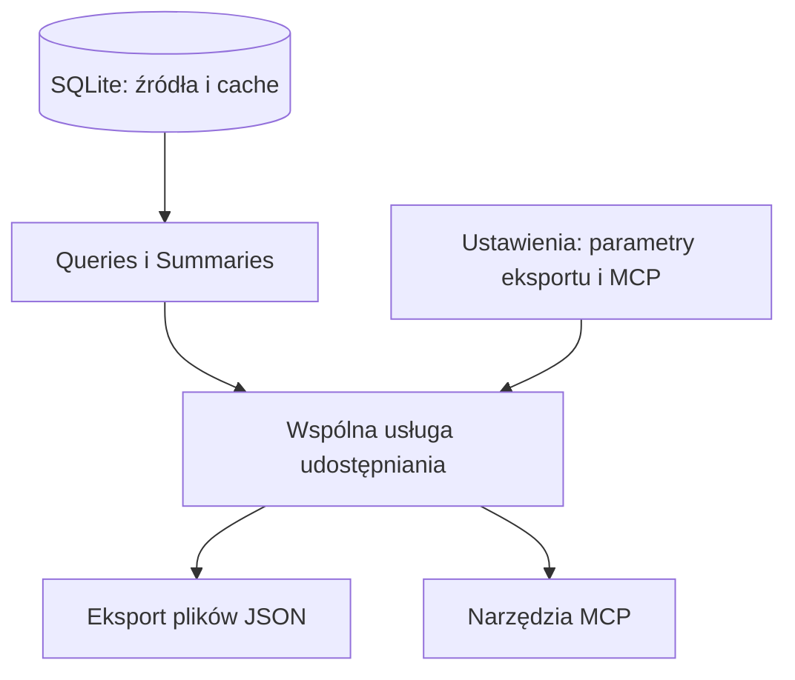

# Plan wspólnego udostępniania danych przez eksport i MCP

Data: 2026-10-22. Status: propozycja wdrożenia na podstawie wstępnych wymagań użytkownika. Dokument opisuje przyszłe zmiany; serwer MCP i nowe ustawienia nie są jeszcze zaimplementowane.

Celem jest jeden zestaw reguł doboru parametrów, obliczeń, dat i jakości danych, używany przez eksport plików oraz lokalny MCP. Pierwsze wydanie MCP ma umożliwić przegląd katalogu, pobranie podsumowań dziennych oraz średnich z całego wskazanego okresu. Bardziej złożone analizy będą dodawane po sprawdzeniu tego przepływu.

## Stan obecny i zmiany potrzebne przed MCP

| Obszar | Stan obecny | Planowana zmiana |
| --- | --- | --- |
| Parametry | `Queries.parameters()` rozpoznaje serie po kluczach `message.field` | Wspólny opis możliwości parametru i niezależne listy udostępniania |
| Wybór w aplikacji | `Settings.parameters` zapamiętuje wybór eksportu; pusta lista oznacza w UI wszystkie serie | Wersjonowane ustawienia, w których pusta lista jednoznacznie oznacza brak udostępnienia |
| CLI | Eksport bez `--parameters` wybiera wszystkie serie, pomijając zapamiętany wybór UI | Wszystkie punkty eksportu respektują tę samą listę dozwolonych parametrów |
| Obliczenia | `summaries.py` ma reguły średnich, kategorii i ostatniej obserwacji | Zachowanie tych reguł we wspólnej usłudze danych |
| Cache | `Summaries.daily()` może zapisać wynik przez osobne połączenie | Jawny tryb odczytu bez publikowania cache, obowiązkowy w MCP |
| Spójność | Eksport czyta dane i kompletność w jednej transakcji WAL | Ta sama zasada dla całej odpowiedzi MCP, także przy kilku metrykach |
| Format | Eksport v2: nagłówek i tablica wierszy per parametr | Ten sam opis parametrów, kolumn, metod i jakości; MCP dodaje ograniczone strony |
| Czas | Momenty rekordów w UTC, granice dni Europe/Warsaw | Osobne metadane strefy kalendarza i reprezentacji znaczników czasu |

Nie planuje się ponownego importu FIT ani migracji fizycznych czasów pomiarów. Na tym etapie nie ma potrzeby migracji schematu SQLite. Zmiany ustawień i kontraktu udostępniania mają własne wersje, niezależne od wersji bazy.

## Kiedy uruchamiany i czego potrzebuje

Użytkownik wskazuje w aplikacji parametry dostępne w każdym kanale. Eksport uruchamia przyciskiem lub CLI. Lokalny klient MCP uruchamia oddzielny proces serwera i wywołuje jego narzędzia. Aplikacja okienkowa nie musi działać podczas odczytu MCP.

Potrzebne są istniejąca, obsługiwana wersja SQLite oraz poprawne ustawienia aplikacji z lokalizacją danych i listami parametrów. MCP nie pobiera danych z Garmin, nie wymaga logowania Garmin, nie inicjalizuje ani nie migruje bazy. Brak lub zbyt nowa baza daje komunikat, że należy przygotować ją w aplikacji.

## Wspólna warstwa danych



Usługa nie importuje Qt ani transportu MCP. Przyjmuje kanał, jawny wybór parametrów, zakres dat i sposób przedstawienia czasu. Waliduje wybór, otwiera spójny odczyt i korzysta z obecnych zapytań oraz reguł podsumowań. Adapter plików zapisuje wyniki strumieniowo; adapter MCP buduje ograniczoną odpowiedź. Nie należy generować plików eksportu tylko po to, żeby następnie odczytać je w MCP.

Opis parametru obejmuje stabilny klucz, polską etykietę, jednostkę, rodzaj źródła, metodę podsumowania, dostępne operacje i zalecaną precyzję prezentacji. Pierwsza wersja używa istniejących kluczy `message.field`; aliasy takie jak `rhr` i `hrv_night` wymagają później osobnej, wersjonowanej definicji znaczenia.

Jedno połączenie i jedna transakcja odczytu obejmują katalog użyty do zapytania, wszystkie wybrane wartości, rewizję danych i kompletność. Wymaga to umożliwienia odczytu katalogu przez przekazane połączenie. Zmiana rewizji podczas importu nie wpływa na rozpoczętą odpowiedź.

MCP korzysta z aktualnego cache, jeśli istnieje. Przy jego braku liczy wynik w pamięci bez zapisywania do SQLite. Należy rozdzielić odczyt/obliczenie od publikacji cache w `Summaries`; samo otwarcie głównego połączenia `mode=ro` nie wystarcza, ponieważ obecna publikacja tworzy drugie połączenie. Eksport nadal może publikować cache według obecnych zasad rewizji i blokady writera. Długie obliczenia muszą reagować na anulowanie i mieć ograniczony czas wykonania.

## Sterowanie parametrami w aplikacji

W Ustawieniach powstaje sekcja „Udostępnianie danych” z tabelą:

| Parametr | Jednostka | Eksport plików | MCP | Dostępne podsumowanie |
| --- | --- | --- | --- | --- |
| Tętno | bpm | wybór | wybór | średnia dostępnych próbek |
| Nocne podsumowanie Garmin | według źródła | wybór | niedostępne w pierwszym wydaniu | źródłowe podsumowanie Garmin |

Obie kolumny są niezależne. Można udostępniać parametr tylko w plikach albo tylko przez MCP. Wybór nie wpływa na import i przeglądanie w sekcji Dane. Parametry bez obsługiwanej operacji MCP mają wyłączony checkbox i krótkie wyjaśnienie. Widoczne są akcje zaznaczenia i odznaczenia grupy oraz skopiowania wyboru między kanałami, wyłącznie w zakresie obsługiwanych parametrów.

Lista eksportowa w Ustawieniach określa, co można wyeksportować. Ekran Eksport pozwala dodatkowo wybrać podzbiór dla konkretnego pakietu. CLI bez `--parameters` korzysta z listy eksportowej; jawny argument może ją zawęzić, ale nie ominąć. Wspólna walidacja obejmuje także bezpośrednie wywołanie eksportera. Nie należy po cichu usuwać nieznanych lub wyłączonych metryk z jawnego żądania — użytkownik otrzymuje precyzyjny błąd wyboru.

Nowe ustawienia zawierają wersję oraz jawne listy `export_parameters` i `mcp_parameters`, osobny ostatni wybór pakietu i przełącznik `mcp_enabled`. Nazwy są propozycją implementacyjną. Puste listy oznaczają „żaden”. Migracja zachowuje stary niepusty wybór eksportu; dawną pustą listę zamienia jednorazowo na jawny zestaw obecnie znanych parametrów, aby zachować dotychczasowe zachowanie. Migrację wykonuje aplikacja lub CLI z gotowym katalogiem, nigdy serwer MCP. Przy braku bazy odkłada się ją do czasu uzyskania katalogu. Nowo rozpoznane parametry nie włączają się samoczynnie. MCP początkowo jest wyłączony i ma pustą listę.

Ustawienia zapisuje się atomowo. MCP odczytuje politykę przed każdym żądaniem i sprawdza ją ponownie przed wysłaniem odpowiedzi. Zmiana listy metryk, wyłączenie MCP albo zmiana folderu danych unieważnia rozpoczętą odpowiedź i kursory; wyłączenie działa bez restartowania klienta. Niepoprawny plik ustawień nie może przywrócić domyślnego udostępniania wszystkich danych. Eksport korzysta z wyboru zatwierdzonego przy rozpoczęciu zadania; zmiana ustawień nie usuwa wcześniej wygenerowanych pakietów.

## Pierwsza wersja MCP: trzy narzędzia

| Narzędzie | Parametry | Odpowiedź |
| --- | --- | --- |
| `garmin_catalog` | opcjonalny `cursor` | Tylko włączone i obsługiwane metryki: klucz, etykieta, jednostka, metoda, dostępny zakres rozpoznanych czasów, limity |
| `get_daily` | `date_from`, `date_to`, wymagane `metrics[]`, opcjonalny `cursor` | Dzienne podsumowania wybranych metryk, liczności i jakość danych |
| `get_period_stats` | `date_from`, `date_to`, wymagane `metrics[]` | Jedno podsumowanie całego wskazanego okresu dla każdej metryki: średnia, minimum, maksimum, liczby próbek i dni z poprawnymi pomiarami |

Pierwszy katalog obejmuje pięć parametrów z obecnego `MEAN_PARAMETERS`: `hrv_value.value`, `monitoring.heart_rate`, `respiration_rate.respiration_rate`, `spo2_data.reading_spo2` i `stress_level.stress_level_value`, o ile są obecne w bazie i włączone. Są to średnie próbek w dniu kalendarzowym. Nie należy nazywać ich nocnym HRV, tętnem spoczynkowym ani nocnym oddechem.

`get_daily` zwraca średnią, minimum, maksimum, liczności jakości i pierwszy/ostatni poprawny czas. To wykorzystuje istniejące obliczenia bez dodawania median, odchylenia standardowego i nowego sposobu agregacji. Każda metryka ma własną tabelę kolumnową z tym samym układem co odpowiadająca jej historia eksportu. Takie rozwiązanie zachowuje znaczenie danych, a klient może łączyć tabele po dniu bez obliczania statystyk z próbek. Nie wymaga się jednej szerokiej tabeli dla różnych rodzajów źródeł.

`get_period_stats` obejmuje te same pięć metryk i zwraca średnią dostępnych poprawnych próbek z całego żądanego zakresu dat, bez ich wysyłania do klienta. Korzysta z niezaokrąglonych podsumowań dziennych: `mean = sum(mean_day * valid_count_day) / sum(valid_count_day)`. To ta sama zasada co w obecnym miesięcznym eksporcie; dzień z większą liczbą próbek ma większą wagę. Nie jest to średnia ważona czasem ani nieważona średnia dni. Wspólna funkcja łączenia podsumowań powinna obsługiwać zarówno miesiące eksportu, jak i dowolny okres MCP, bez zmiany wyników obecnego eksportu.

Każda metryka otrzymuje tabelę kolumnową z jednym wierszem: `period_from`, `period_to`, `mean`, `minimum`, `maximum`, `valid_count`, `invalid_count`, `excluded_count`, `untimed_count`, `valid_days`, `requested_days`, `first_time`, `last_time`, `day_basis`. `valid_days` to liczba dni z co najmniej jedną poprawną próbką, a `requested_days` obejmuje wszystkie lokalne daty żądanego okresu. `aggregation` opisuje `method: sample_mean`, `period: range` i `weighting: valid_sample_count`. Brak poprawnych próbek daje `null` dla średniej, minimum, maksimum i czasów poprawnych obserwacji, przy zachowaniu liczników. Reguły wykluczania próbek, strefa i wybór parametrów są identyczne jak w `get_daily` i eksporcie.

Przykładowe wywołanie: `get_period_stats(date_from="2026-09-01", date_to="2026-09-30", metrics=["monitoring.heart_rate", "hrv_value.value"])`. Wynik września musi zgadzać się z odpowiadającym mu miesięcznym eksportem przed zaokrągleniem prezentacji. W pierwszej wersji metoda zwraca podsumowanie całego okresu; grupowanie na tygodnie/miesiące oraz wybór mediany lub odchylenia standardowego pozostają późniejszym rozszerzeniem.

Nie ma domyślnego wyboru wszystkich metryk. Puste `metrics[]` jest błędem. Początkowo można wybrać od jednej do pięciu metryk; limit odpowiada rzeczywistemu zakresowi pierwszego wydania. Katalog nie skanuje całych próbek przy każdym wywołaniu: zakres dostępności wynika z indeksowanych czasów wiadomości i powiązań katalogu; plan zapytania oraz opóźnienie trzeba zmierzyć. Nie pobiera listy wszystkich brakujących dni całej historii — szczegóły braków dotyczą stron żądanego zakresu.

Oryginalne podsumowania Garmin nadal są dostępne w eksporcie. W MCP dołączą później jako odrębna operacja lub jednoznacznie opisany rodzaj serii. Obecna baza może zawierać kilka takich rekordów dziennie; nie wolno wcisnąć ich w pojedynczy wiersz dnia przez arbitralny wybór ostatniego rekordu.

## Wspólny kontrakt odpowiedzi i eksportu

Podobieństwo kanałów oznacza tę samą metrykę, jednostkę, metodę, wersję algorytmu, dzień przypisania, reguły braków i wynik liczbowy przed formatowaniem. Przy tej samej rewizji i zakresie podsumowania muszą być zgodne. Układ pakietu plików i obwiednia odpowiedzi MCP mogą się różnić.

Oba kanały używają nagłówka i wierszy: nazw kolumn, jednostek oraz etykiet nie powtarza się w każdym rekordzie. Zachowujemy istniejące nazwy `parameter`, `columns` i `data`; w MCP lista `series` zawiera tabele poszczególnych parametrów. Nie wprowadzamy równolegle nazw `rows` i `data` dla tego samego pojęcia. Przykładowy fragment kontraktu, bez rzeczywistych pomiarów:

```json
{
  "schema_version": 1,
  "calendar_timezone": "Europe/Warsaw",
  "timestamp_timezone": "Europe/Warsaw",
  "data_revision": 123,
  "series": [{
    "parameter": "monitoring.heart_rate",
    "unit": "bpm",
    "summary_origin": "application",
    "aggregation": {"method": "sample_mean", "period": "day", "algorithm_version": 1},
    "columns": ["day", "mean", "minimum", "maximum", "valid_count", "invalid_count", "excluded_count", "untimed_count", "first_time", "last_time", "day_basis"],
    "data": []
  }],
  "gaps": [],
  "truncated": false,
  "next_cursor": null
}
```

Wersja kontraktu MCP jest niezależna od obecnego JSON v2. W plikach v2 można dodać jednoznaczne metadane czasu bez zmiany istniejących kolumn i ich znaczenia. Zachowujemy obecne `timezone` dla zgodności i opisujemy je jako strefę kalendarza. Zmiana domyślnej reprezentacji czasu lub precyzji istniejących wartości wymaga nowej wersji eksportu, nie cichej modyfikacji v2.

Eksport nadal tworzy nowy folder, manifest oraz pełne pliki historii i szczegółów. Nie otrzymuje limitu 92 dni ani obcięcia danych z powodu limitu odpowiedzi MCP. Adapter plików strumieniowo konsumuje wspólny wynik do końca; ukończony manifest oznacza kompletność pakietu. Starsze eksporty pozostają nienaruszone.

MCP domyślnie zaokrągla wyłącznie wynik prezentacji według metryki, np. tętno i HRV do liczb całkowitych. Nie zmienia wartości SQLite ani precyzji obliczeń/cache. Precyzja jest opisana w metadanych; minimum i maksimum nadal pochodzą z tych samych poprawnych próbek. Eksport v2 zachowuje dotychczasową precyzję. Ewentualny wspólny profil prezentacji plików wprowadza się jawnie w kolejnej wersji kontraktu.

## Daty i godziny

Momenty pozostają w UTC wewnątrz rdzenia. Granice dat i miesięcy nadal wyznacza `Europe/Warsaw`. MCP zwraca rozpoznane znaczniki czasu lokalnie z pełną datą oraz offsetem, np. `2026-10-22T13:30:00+02:00`. Eksport v2 nadal zwraca UTC, a jego nagłówek podaje `timestamp_timezone: "UTC"` i `calendar_timezone: "Europe/Warsaw"`. To dwie reprezentacje tego samego momentu, bez zmiany przynależności do dnia.

Zakres `date_from`–`date_to` obejmuje obie daty. W rdzeniu oznacza przedział od lokalnej północy początku włącznie do lokalnej północy po ostatnim dniu wyłącznie. Dni zmiany czasu nie są zastępowane stałym odcinkiem 24 godzin. Przyszłe `get_window` będzie używać granic `[start, end)` z rzeczywistym czasem trwania; niejednoznaczny lub nieistniejący lokalny czas wejściowy wymaga doprecyzowania, zamiast zgadywania.

`requested_day` zawsze pozostaje dniem żądania archiwum. Nie zastępuje czasu pomiaru, dnia snu ani lokalnej daty urządzenia. Nierozpoznany czas ma `null`; takie rekordy można ewidencjonować w `untimed_count` według dotychczasowych reguł, ale nie włączać do średniej. `local_timestamp` bez potwierdzonego powiązania z UTC nie jest automatycznie czasem Warszawy.

Dla przyszłego snu i aktywności stosuje się pełne daty początku i końca. Sama godzina `HH:MM` nie wystarcza. Przypisanie nocy do daty wymaga reguły i oznaczenia źródła; nie należy utożsamiać średniej z dnia z podsumowaniem nocy Garmin. Warszawa jest strefą analizy, a nie potwierdzeniem miejsca pobytu podczas pomiaru.

## Braki i jakość

Wspólna usługa opisuje osobno brak potwierdzonego archiwum, nieukończone dekodowanie oraz brak poprawnych próbek konkretnej metryki. `gaps` używa krótkich zakresów dat z przyczyną i identyfikatorem metryki tam, gdzie dotyczy tylko jednej serii. Brak danych to `null` lub jawnie opisany brak wiersza, nigdy zero. Dla spójności z obecnymi plikami v2 nie dodaje się w nich sztucznych wierszy brakujących dni; dodatkowe metadane pozwalają odtworzyć pełną oś dat.

Pierwsze MCP zwraca te same liczniki `valid_count`, `invalid_count`, `excluded_count` i `untimed_count`, a także `day_basis`. Luki odnoszą się wyłącznie do zakresu zwróconej strony, obejmują także dni bez żadnego wiersza i nie oznaczają przerw wewnątrz dnia. Dostępny zakres z katalogu nie gwarantuje ciągłości ani pełnej doby pomiarów.

Nie obliczamy `wear_pct` z liczby próbek: zmienny interwał, ładowanie i brak synchronizacji nie dowodzą czasu noszenia. Pole pozostaje poza pierwszą wersją. Ewentualny późniejszy wskaźnik pokrycia próbkami musi mieć własną nazwę i jawny algorytm. Procent noszenia wymaga potwierdzonego źródła lub osobnej zwalidowanej metody.

## Limity, stronicowanie i błędy

`get_daily` ma maksymalnie 92 dni na stronę, a obie metody odczytu wymagają maksymalnie pięciu wybranych metryk. Szerszy poprawny zakres dzienny jest przetwarzany kolejnymi stronami; 92 dni oznacza limit zakresu pojedynczej strony dziennej, a nie odrzucenie całego zapytania. Nie zmieniamy samoczynnie dnia na tydzień lub miesiąc, ponieważ zmieniłoby to znaczenie odpowiedzi.

W `get_period_stats` limit 92 dni nie ogranicza całego okresu, ponieważ klient dostaje tylko jeden wiersz na metrykę. Podsumowania można odczytywać wewnętrznie w odcinkach do 92 dni i łączyć w jednej transakcji odczytu. Końcowa średnia zawsze obejmuje cały żądany okres; nie wolno publikować średniej pierwszego odcinka jako wyniku pełnego zakresu ani wymagać od klienta samodzielnego łączenia średnich. Obowiązują limit czasu wykonania, anulowanie i budżet bajtów. Test wydajności obejmie co najmniej dwuletni zakres, także bez aktualnego cache.

Proponowany dodatkowy limit to 16 KiB zserializowanego wyniku narzędzia, obejmujący wszystkie bloki treści, metadane, luki i kursor. To mierzalny limit bajtów; cel 6–8 tys. tokenów należy sprawdzić na reprezentatywnych odpowiedziach, ponieważ nie ma stałego przelicznika dla wszystkich klientów i modeli. Nie można bez kontroli powielać całego dużego JSON w kilku reprezentacjach wyniku SDK.

Strony `get_daily` dzieli się na granicach dni, równocześnie dla wszystkich wybranych metryk. Limit bajtów może zmniejszyć liczbę dni poniżej 92. Także dni bez pomiarów przesuwają granicę strony. Metadane i luki podlegają temu samemu budżetowi; długie listy luk są grupowane. Graniczny przypadek, w którym nawet jeden dzień nie mieści się w limicie, musi być obsłużony i sprawdzony testem, np. mniejszym wyborem metryk, bez nieskończonego zwracania tego samego kursora.

`get_period_stats` ma stałą liczbę wierszy, dlatego zwraca całość z `truncated: false` i `next_cursor: null`. Aby metadane nie rosły z długością okresu, jego `gaps` podaje liczbę dni dla poszczególnych przyczyn i metryk, z oznaczeniem `gaps_format: day_counts`; `get_daily` zachowuje zakresy dat z `gaps_format: date_ranges`. Dokładne daty braków można odczytać przez `get_daily`. Nie powstają długie listy wszystkich brakujących dni ani rekordy dzienne w odpowiedzi okresowej. Anulowanie lub upływ czasu obliczeń daje jawny błąd, zamiast częściowej średniej.

Każda strona podaje żądany zakres, zakres zwrócony, `truncated` oraz `next_cursor`. Kursor wiąże oryginalne zapytanie, następny dzień, tożsamość bazy, rewizję danych i wersję polityki udostępniania. Serwer sprawdza te warunki przy kontynuacji. Zmiana danych lub polityki unieważnia kursor i wymaga rozpoczęcia zapytania od nowa; nie utrzymujemy długiej transakcji WAL pomiędzy żądaniami. Kursor nie zastępuje walidacji uprawnień.

Przekroczenie wielkości prawidłowego wyniku powoduje stronicowanie. Nieprawidłowe daty, nieznana/wyłączona metryka, błędny lub nieaktualny kursor, anulowanie i brak bazy są osobnymi, zwięzłymi błędami. Nie są maskowane jako pusta odpowiedź lub udany wynik częściowy. Budżet czasu wykonania i anulowanie chronią także zimny odczyt bez cache; ich wartości ustala się po pomiarze na istniejących indeksach, a następnie utrwala w kontrakcie.

## Lokalny proces MCP i pakowanie

Rekomendowany transport pierwszego wydania to `stdio` z oficjalnym Python SDK MCP. Klient uruchamia proces i komunikuje się przez standardowe wejście/wyjście. Nie potrzeba portu HTTP, procesu działającego stale w tle ani usługi Windows. Jest to najprostszy wariant pod warunkiem, że docelowy klient obsługuje lokalne `stdio`; zgodność trzeba sprawdzić w etapie 1. Klient wymagający URL oznacza osobny zakres Streamable HTTP, bez automatycznego rozszerzania pierwszej wersji.

UI umożliwia włączenie dostępu, wybór parametrów i skopiowanie konfiguracji klienta. Nie dodajemy przycisku startującego drugi, nieużywany proces `stdio`; właściwy proces uruchamia klient. Przełącznik dostępu jest sprawdzany również przez już działające procesy serwera.

Serwer ma oddzielny punkt wejścia, np. `garmin_database/mcp_server.py`, oraz oddzielny EXE z działającymi strumieniami procesu. Obecny `desktop.py` jest pakowany przez `--windowed` i nie może być bez sprawdzenia użyty jako serwer `stdio`. SDK należy przypiąć do konkretnej, zweryfikowanej wersji i odseparować od importów Qt. Nie zakładamy dostępności Pythona w docelowej dystrybucji.

MCP otwiera SQLite tylko do odczytu i nie udostępnia arbitralnego SQL, ścieżek plików, oryginalnych FIT, operacji eksportu na dysk, importu ani konfiguracji. Logi techniczne trafiają na `stderr`, bez pomiarów i danych sesji Garmin; `stdout` zawiera wyłącznie komunikaty protokołu. Serwer nie korzysta z magazynu DPAPI ani połączeń Garmin. W testach dystrybucji proces jest uruchamiany z przekierowanymi strumieniami i bez widocznego okna pomocniczego.

## Kolejność wdrożenia i kryteria odbioru

| Etap | Zakres | Warunek ukończenia |
| --- | --- | --- |
| 1. Kontrakt i zgodność klienta | Potwierdzenie `stdio`, schematy odpowiedzi, opis pięciu metryk, czasu, braków i limitów | Przykłady syntetyczne oraz ustalona wersja SDK i format konfiguracji klienta |
| 2. Wspólna usługa | Katalog na przekazanym połączeniu, współdzielony odczyt, łączenie podsumowań dziennych dla miesięcy i dowolnego okresu, oddzielenie publikacji cache, metadane czasu i jakości | Eksport zachowuje wyniki v2; zgodność średnich okresowych, odczytu bez zapisu i spójność WAL potwierdzone testami |
| 3. Wybór parametrów | Migracja ustawień, tabela UI z dwiema listami, podzbiór pakietu, ta sama walidacja w GUI/CLI/eksporterze | Wyłączonego parametru nie można udostępnić przez inny punkt wejścia; pusty wybór pozostaje pusty po restarcie |
| 4. Trzy narzędzia MCP | Katalog, podsumowania dzienne i całego okresu, limit stron i bajtów, kursory, anulowanie, przeładowanie polityki | Klient odczytuje wynik, duży zakres dzienny stronicuje się bez utraty dni, średnia okresowa obejmuje cały żądany zakres, brak zapisów do bazy i pobrań Garmin |
| 5. Dystrybucja i odbiór | Oddzielny EXE, konfiguracja klienta, pomiar czasu/rozmiaru, instrukcja i testy końcowe | Zbudowane GUI i MCP działają na Windows 11, a proces serwera zachowuje protokół i wszystkie ograniczenia |

W etapach 2–3 należy utrzymać działający eksport przed dołączeniem MCP. Każdy większy etap kończy osobny Conventional Commit z jawną listą plików; push wymaga osobnego zlecenia.

Testy jednostkowe obejmą wybór parametrów, migrację pustej listy, semantykę metryk, format czasu i DST, zaokrąglenia wyłącznie na wyjściu oraz limitowanie odpowiedzi. Integracyjne porównają podsumowania eksportu i MCP z tej samej rewizji, sprawdzą brak zapisów po zimnym odczycie MCP, spójność podczas importu, brak wycieku po odznaczeniu metryki i ciągłość stron także przez puste dni. Próby złego kursora, zmiany bazy i ustawień, limitu z długą listą luk oraz anulowania są częścią kontraktu.

Testy `get_period_stats` obejmą dni o różnej liczbie próbek, zakres jednego dnia, część miesiąca, przełom miesiąca/roku i DST, dni bez danych oraz okres bez poprawnych próbek. Wynik należy porównać z bezpośrednią średnią syntetycznych próbek i z miesięcznym eksportem dla tego samego okresu. Podział pracy na odcinki nie może zmieniać wyniku ani rewizji odczytu, a sumaryczne metadane braków muszą mieścić się w budżecie także dla długiej historii.

Testy UI sprawdzą niezależność wyborów i ich zapis. Testy protokołu oraz zbudowanego EXE obejmą inicjalizację MCP, listę narzędzi i wywołania przez prawdziwe strumienie, również gdy GUI jest zamknięte. Wymagany pozostaje próg coverage rdzenia i CLI z gałęziami co najmniej 85%; GUI jest osobną warstwą. Dokumentacja planu nie wymaga uruchamiania całego zestawu aplikacji — te kryteria dotyczą późniejszej implementacji.

## Rozszerzenia po pierwszym odbiorze

1. Źródłowe podsumowania Garmin przez jawny kontrakt zachowujący wiele rekordów i ich znaczenie okresu. Dopiero po weryfikacji wprowadzać nazwy tętna spoczynkowego lub nocnego HRV.
2. `get_window`: jeden dzień/ograniczona liczba godzin, jawne metryki, koszyki czasu i liczności próbek; surowe obserwacje tylko na wyraźne żądanie z osobnym limitem. Rozdzielić agregację czasową od odczytu surowego, bo interwał jednej minuty nie oznacza pojedynczej surowej próbki.
3. Rozbudowa `get_period_stats` o tygodnie/miesiące i dodatkowe statystyki oraz dodanie `compare_periods`: jawny wybór statystyk, definicja tygodnia oraz rozróżnienie statystyk próbek od statystyk dni. Obecne miesięczne i planowane okresowe średnie są ważone liczbą próbek; nie należy zastąpić ich nieważoną średnią dni.
4. `get_sleep`, `get_activities` i `find_outliers`: po potwierdzeniu dostępności źródeł i reguł przypisania czasu. Obecne archiwa dobrostanu nie gwarantują pełnej historii aktywności ani wszystkich metryk z przykładu użytkownika.
5. Streamable HTTP, Raspberry Pi i dostęp z innych urządzeń jako osobny projekt transportu, uwierzytelniania i utrzymania procesu.

Mediana surowych próbek nie wynika z median dziennych ani z obecnego cache średnich. Także odchylenie standardowe i różnice okresów wymagają określenia populacji i nowych obliczeń/testów. Nie należy deklarować tych funkcji jako dostępnych po samym dodaniu adaptera MCP. Serwer przekazuje statystyki i pochodzenie danych; nie interpretuje ich medycznie.

## Co produkuje i co może pójść nie tak

Eksport produkuje trwały pakiet plików; MCP zwraca ograniczoną odpowiedź na konkretne zapytanie bez zapisu plików. Oba kanały korzystają z tych samych reguł danych i mogą działać podczas importu. Niepełny import jest jawnie opisany; nie jest utożsamiany z brakiem pomiarów lub zerowym stresem. Przerwany eksport nie uzyskuje ukończonego manifestu, a przerwane MCP nie publikuje częściowego wyniku jako pełnego.

Ryzyka pierwszego wdrożenia to klient bez obsługi `stdio`, długi odczyt po unieważnieniu cache i nadmiar metadanych w małej odpowiedzi. Etapy 1, 2 i 4 mają je sprawdzić przed odbiorem. Zmiana ustawień z innego procesu wymaga ponownej walidacji, a nowy import między stronami może wymagać powtórzenia zapytania. To świadomy kompromis prostoty bez utrzymywania otwartych, długich transakcji i dodatkowych kopii prywatnych wyników.

## Gdzie to znaleźć w kodzie

Istniejące punkty: `garmin_database/query.py`, `summaries.py`, `exporter.py`, `settings.py`, `cli.py`, `ui.py` oraz `scripts/build_windows.ps1`. Nowa usługa i punkt wejścia MCP powstaną dopiero podczas implementacji; wtedy należy umieścić przy nich odnośnik do tego dokumentu. Obecny plan nie zmienia działania tych modułów.

Powiązane dokumenty: [architektura](03-architecture.md), [eksport](05-export.md), [schemat SQLite](10-sqlite-schema.md), [UI](11-desktop-ui.md) i [testy/pakowanie](12-running-and-testing.md).

## Źródła zewnętrzne i usługi

Odczyt danych jest lokalny i nie wymaga zewnętrznej usługi. Zależnością implementacyjną będzie oficjalny SDK MCP. Sprawdzono dokumentację 2026-10-22; wersję pakietu należy przypiąć podczas implementacji.

- [Transporty MCP: stdio i Streamable HTTP](https://modelcontextprotocol.io/specification/2025-11-25/basic/transports) — uruchamianie procesu przez klienta i zasady standardowych strumieni.
- [Oficjalny MCP Python SDK](https://github.com/modelcontextprotocol/python-sdk) — implementacja transportu i narzędzi; nie piszemy własnego protokołu.
- [RFC 3339](https://www.rfc-editor.org/rfc/rfc3339.html) — jednoznaczny zapis daty i czasu z offsetem.
- [Python ZoneInfo](https://docs.python.org/3/library/zoneinfo.html) — strefy IANA i przejścia czasu letniego/zimowego.
